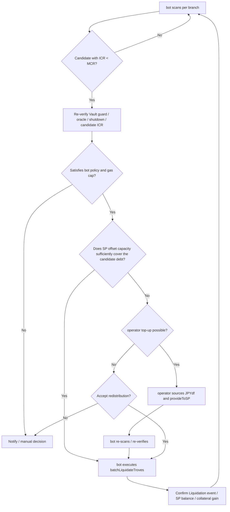

# Liquidation Management Policy

## Positioning

This document defines the JPYdf Day-1 liquidation operating policy. The on-chain liquidation behavior is governed by
[`../../product/spec/Liquity-v2-Core-Spec.md`](../../product/spec/Liquity-v2-Core-Spec.md); the SP / JIT
terminology and implementation boundary by
[`../design/Liquidation-Backstop-And-JIT-Policy.md`](Liquidation-Backstop-And-JIT-Policy.md);
the bot implementation scope by [`Liquidation-Bot-Plan.md`](../../../engineering/plans/Liquidation-Bot-Plan.md);
the corporate SP seed, self-mint, and LP allocations by
[`Day1-Self-BS-Launch-Commitment.md`](../../../contributors/deltaforesight/commitments/Day1-Self-BS-Launch-Commitment.md);
the product-side branches, SP requirements, and planned exposure by
[`Mainnet-Launch-Product-Decision-Record.md`](../../launch/decisions/Mainnet-Launch-Product-Decision-Record.md);
and the calculation rationale by
[`Day1-Self-BS-Initial-Liquidity-Plan.md`](../../../contributors/deltaforesight/commitments/Day1-Self-BS-Initial-Liquidity-Plan.md).

## Purpose and Basic Stance

The purpose of liquidation management is to avoid leaving undercollateralized Troves unattended, and to contain the risk of bad debt and JPYdf depeg.

DeltaForesight's Liquity v2 core offsets the debt of an undercollateralized Trove against the branch-local Stability Pool
(SP), and redistributes the debt and collateral that the SP cannot absorb to the active Troves on the same branch.
Redistribution is a protocol safety fallback, but because it imposes an unexpected debt increase on existing Trove
users, operations should handle as much as possible via SP offset.

The Day-1 policy processes in the following order.

1. Pre-fund the SP to absorb normal-sized liquidations.
2. The liquidator bot detects candidates, observes SP capacity, re-verifies the final ICR, and performs dry-run / live submission of `batchLiquidateTroves`.
3. For large liquidations where SP capacity is insufficient, the operator non-atomically sources JPYdf and tops up the SP of the target branch before liquidating.
4. If the operator top-up cannot be done in time, or exceeds the loss tolerance, notify and explicitly choose manual replenishment,
   liquidation with redistribution, or a pause decision.

## Day-1 Implementation Boundary

| Area | What Day-1 can do | What Day-1 does not do |
| --- | --- | --- |
| Core liquidation | `TroveManager.batchLiquidateTroves(uint256[])` performs SP offset and redistribution | Core does not automate JPYdf sourcing, DEX swap, or SP top-up |
| Stability Pool | Deposit JPYdf via `provideToSP(amount, doClaim)`, and after liquidation recover gains via `withdrawFromSP` / `claimAllCollGains` | `DFStabilityPool` forbids deposit → withdraw in the same block, so a design that returns the SP position to zero inside a flash loan callback does not work |
| Liquidator bot | `LiquidationCandidateGetter` scan, `lastZombieTroveId` pickup, SP capacity logging, Vault guard, gas estimate, policy decision, optional live tx submission | JPYdf/USDC swap, automatic execution of `provideToSP`, atomic bundle, collateral sale / accounting |
| JIT / backstop | Operator prepares JPYdf from inventory, self-mint, or Uniswap v4 JPYdf/USDC and tops up the SP non-atomically | An Atomic JIT executor using a Morpho / Aave flash loan is not implemented in Day-1 |
| Notification / monitoring | Check operational logs such as bot log / JSON evidence / systemd | Slack / Prometheus / private relay are a follow-up gate after production hardening |

## Initial Allocation Assumptions

The Product Decision Record is authoritative for adopted branches, per-branch SP requirements, and planned exposure.
The Self-B/S Launch Commitment is authoritative for company-funded SP seed, self-mint, and LP allocation. JIT capacity
is an operational estimate that depends on DEX depth, operator inventory, and transaction feasibility;
`batchLiquidateTroves` does not reserve or guarantee it.

## SP / JIT Replenishment Decision

The Day-1 SP operation judges the branch-wide minimum coverage and the per-liquidation-batch offset coverage separately.
When raising the `mintCap` of an active branch, first satisfy the proactive coverage gate in
[`Active-Branch-Cap-Ramp-Runbook.md`](../runbooks/Active-Branch-Cap-Ramp-Runbook.md)
rather than a reactive SP top-up.

| Metric | Day-1 baseline | Decision |
| --- | --- | --- |
| Branch SP target | Per-branch requirement in the Product Decision Record | Do not publicly launch if `targetSpJpydf` is not reached |
| Batch offset coverage | 100% of planned batch debt | The bot's `min_sp_offset_coverage_bps = 10000` is the standard. If below it, do not auto-execute and route to a JIT top-up / redistribution / pause decision |
| Stress-event readiness | Approved SP target plus operator JIT | Confirm estimates against the Day-1 Self-B/S rationale and never present JIT as guaranteed capacity |
| SP concentration feasibility | Manual reallocation across active branches | Moving SP requires a separate multisig transaction because of the DFStabilityPool same-block guard; operate with a proactive watch list |

If, post-launch, branch debt increases and SP target is missed, or if the bot's planned batch continues to
skip with SP offset coverage below 100%, the risk owner records one of the following in the
decision log and executes it.

1. Perform an SP top-up and restore target / minimum coverage.
2. Specify the JIT funding source and execution owner, create 100% offset coverage for that batch, and then liquidate.
3. Liquidate after recording the reason for accepting redistribution, the affected branch, and the user communication owner.
4. Stop the path of new dToken mint and new inflows via cap reduction / halting UI exposure / halting campaigns. This is not a branch debt ceiling; because Core's debt increase against existing dToken collateral can continue within the range of MCR/CCR/SCR, price, and shutdown conditions, the risk owner records in the decision log which of SP top-up / JIT / redistribution / cap-ramp halt absorbs the residual risk.

## Liquidation Decision Flow



## Bot Execution Sequence

```text
[Caller: bots/liquidator]

1. PriceFeed.fetchPrice()
2. Obtain MCR from AddressesRegistry.MCR() or the branch config's MCR
3. LiquidationCandidateGetter.getLiquidationCandidatesWithLastZombie(...)
4. Re-verify candidates immediately before sending with TroveManager.getCurrentICR(troveId, price)
5. TroveManager.stabilityPool() -> StabilityPool.getTotalJpydfDeposits()
6. Compute SP offset capacity by deducting MIN_JPYDF_IN_SP from total deposits
7. Confirm CollateralVault.backingRatio() / pause state
8. Obtain the gas estimate of TroveManager.batchLiquidateTroves(troveIds)
9. Decide dry-run / skip / live submit according to the execution policy
```

The current bot's revenue estimation does not include collateral disposal and treats gas cost as a loss. In
`protocol-maintenance` mode, sending is allowed within the range of `max_loss_wei_per_tx` and `max_gas_cost_wei`, but a
daily loss cap is not a configuration item in the current backend.

## Day-2 Profit-Seeking Hardening Gate

The current bot is for Day-1 operator maintenance, and is not a `profit-seeking` liquidator that an external keeper can
operate stably for profit. The `profit-seeking` mode remains as a config enum, but its
live startup is fail-closed until collateral disposal and an inventory-aware profit model are in place.
Until the following gate is in place across PR / fork evidence / runbook, do not state in UI, docs, or partner-facing explanations
that "external liquidators can participate as profit seekers."

### Required Profit Model

| Item | Required content | No-Go example |
| --- | --- | --- |
| Gross reward | Estimation of branch, troveId, entireDebt, entireColl, Core gas compensation, JIT/SP gain, liquidation penalty / collateral gain. In P0, compute only the Core gas compensation as `liquidatorGasCompensation` and keep treating full profit as blocked | Treating only gas compensation as full profit and counting it as a surplus |
| Disposal route | Route, min-out, slippage, and quote block to convert received dToken / Underlying back to JPYdf, USDC, or an accounting-basis asset | Assuming the received collateral can be cashed out immediately at spot price |
| Inventory | JPYdf balance, JIT source, inventory cost, maximum input amount per branch | Producing profit with the SP top-up funding source still undetermined |
| Market depth | JPYdf/USDC v4 liquidity, disposal venue depth, max route size, depeg haircut | Valuing the full amount at mid price in a thin pool |
| Gas / relay | Base fee, priority fee, stress multiplier, private relay / public mempool policy, failed bundle handling. In P0, record base fee / priority fee / max fee and the stress multiplier as `gasForecast`; live submit fixes the planned gas limit / gas price into the tx and limits the live tx burst per catch cycle via `max_submissions_per_cycle`, but keeps treating relay / replacement / cancellation / bundle failure handling as blocked | Excluding priority fee spikes or bundle failures from the profit calculation |
| RPC / oracle | RPC quorum, block lag, price freshness, and the difference from the `fetchPrice()` Core ultimately uses. In P0, record the health and block lag of the primary/fallback provider as `rpcQuorum`; a transient RPC / scan / planning failure of the run daemon rewinds to the pre-scan cursor and retries after the poll interval, but keeps treating scanner routing / provider voting / price-source quorum as blocked | Making a send decision on a single RPC / stale price |
| Receipt / accounting | tx status, classification of revert / timeout / replacement / dropped, collateral gain recovery owner, PnL ledger | Treating it as success on mere tx hash issuance |

### Evidence Schema

A PR that unblocks profit-seeking outputs at least the following JSON evidence fields as a stable schema. It must not
include a private key, raw RPC URL, undisclosed Safe nonce, or API key.

| Field | Content |
| --- | --- |
| `profitModelVersion` | The version and commit hash of the revenue calculation logic |
| `candidate` | branch, troveId, ICR, entireDebt, entireColl, oracle price, quote block |
| `liquidatorGasCompensation` | Core's WETH gas compensation, and the collateral gas compensation on the SP offset portion. Does not include SP/JIT gain, collateral sale, or inventory cost |
| `collateralDisposalRoutes[]` | collateral token, route id, venue, minOut, slippageBps, quoteBlock, maxRouteSize |
| `inventory` | `jpydfAvailable`, source, maxInventoryCostWei, branch allocation cap |
| `marketDepth` | JPYdf/USDC v4 depth, sample sell / buy slippage, depeg haircut |
| `gasForecast` | `gas`, `gasPrice`, `baseFeePerGas`, `priorityFeePerGas`, `maxFeePerGas`, `gasCost`, `stressedGasCost`, `stressMultiplierBps` |
| `relayPolicy` | private relay labels, allowPublicMempool, replacement / cancellation policy |
| `rpcQuorum` | `status`, `providerCount`, `requiredAgreement`, `healthyProviderCount`, `maxBlockLag`, `observedBlockLag`, provider labels/status. Does not include raw RPC URLs. Price source agreement is P1 onward |
| `decision` | expectedGrossProfitWei, expectedNetProfitWei, minProfitWei, skipReason |
| `receipt` | txHash, status, blockNumber, gasUsed, classification, receiptTimeoutSecs, supportedClassifications, escalationOwner. P0 dry-run evidence is `not-submitted` / `planning-only`, and only the live submit outcome taxonomy is fixed |

### Staged Activation

| Phase | Execution scope | merge / launch condition |
| --- | --- | --- |
| P0 read-only evidence | Output profit evidence per liquidation candidate but do not send tx | A historical / synthetic fork can classify surplus / loss / thin-SP / route slippage / oracle failure |
| P1 operator-approved submit | The operator reviews the evidence and sends only on a limited branch / limited cap under private relay / RPC quorum | Receipt classification, PnL ledger, collateral disposal owner, and failed tx escalation are in place |
| P2 external keeper reference | Publish config / schema / sample route for external keepers | Permissionless JIT / inventory policy, rate limit, public docs, and support boundary are in place |

Re-enabling `profit-seeking` is not merely a change that relaxes config validation; it is treated as an audit-target
change accompanied by the P0->P1 evidence and tests above.

## Operator SP Top-up Sequence

```text
[Caller: operator / Safe / separate executor]

1. The bot / ops detects an SP shortage and the candidate debt
2. The operator prepares JPYdf
   - Existing inventory
   - Already self-minted JPYdf
   - Sourcing on JPYdf/USDC Uniswap v4
3. Execute StabilityPool.provideToSP(amount, false) on the target branch
4. The bot re-scans / re-verifies the same branch
5. The bot or operator executes TroveManager.batchLiquidateTroves(troveIds)
6. After liquidation, the SP depositor executes withdrawFromSP / claimAllCollGains in a separate tx
7. The accounting / sale / re-SP-ing of the received collateral is handled by a separate operation
```

`DFStabilityPool` records `lastDepositBlock[msg.sender] = block.number` on `provideToSP`, and
`withdrawFromSP` requires `lastDepositBlock[msg.sender] < block.number`.
Therefore, in the Day-1 contract, an Atomic JIT that completes
`provideToSP -> liquidate -> withdrawFromSP -> flash loan repayment` inside a flash loan callback does not hold.

## Notification / Escalation

Day-1 minimum monitoring targets:

| Category | Content |
| --- | --- |
| bot connection failure | RPC failure, chainId mismatch, config invalid, state file write failure |
| Liquidation candidate | branch, troveId, ICR, entireDebt, SP offset capacity, vault guard state |
| Execution decision | dry-run / skip / submit, gas estimate, loss budget decision, tx hash / receipt |
| SP operation | SP JPYdf balance per branch, top-up necessity, post-liquidation collateral gain |

Slack / Prometheus / private relay / RPC quorum are production hardening items, and until the implementation / runbook
is in place they are not treated as "auto-notified."

## When Adding Atomic JIT in the Future

Atomic JIT is not a Day-1 config addition; it is treated as a new audited executor. At minimum, do not put it into production until the following are satisfied.

- Specify whether the funding source is operator inventory / self-mint / DEX swap / flash liquidity.
- Make the design compatible with `DFStabilityPool`'s same-block withdrawal guard. If using a flash loan, premise it on the constraint that the SP position cannot be withdrawn within the same block, and separately explain the repayment funding.
- Freeze the JPYdf/USDC Uniswap v4 route's pool key, hook policy, Universal Router / Permit2 address, min-out, and allowance cleanup.
- Verify the match between the SP deposit and the liquidation-target branch on-chain or via typed config.
- Make loss cap, max gas, min collateral gain, and max slippage mandatory.
- Make the resend / cancellation / nonce management on private relay / bundle failure into a runbook.
- In fork tests, include SP sufficient, SP insufficient, route slippage, oracle failure, Vault pause, shutdown branch, and zombie Trove.

## References

- [`../design/Liquidation-Backstop-And-JIT-Policy.md`](Liquidation-Backstop-And-JIT-Policy.md) — Implementation boundary of SP / JIT / Atomic JIT
- [`Liquidation-Bot-Plan.md`](../../../engineering/plans/Liquidation-Bot-Plan.md) — Implementation plan of the liquidator backend
- [`../design/Day1-Self-BS-Initial-Liquidity-Plan.md`](../../../contributors/deltaforesight/commitments/Day1-Self-BS-Initial-Liquidity-Plan.md) — Day-1 B/S allocation amounts
- [`../design/Liquidity-Route-Policy.md`](../../product/policies/Liquidity-Route-Policy.md) — JPYdf/USDC Uniswap v4 route policy
- [`../../Parameters.md`](../../../Parameters.md) — Source of truth for collateral / risk parameters
