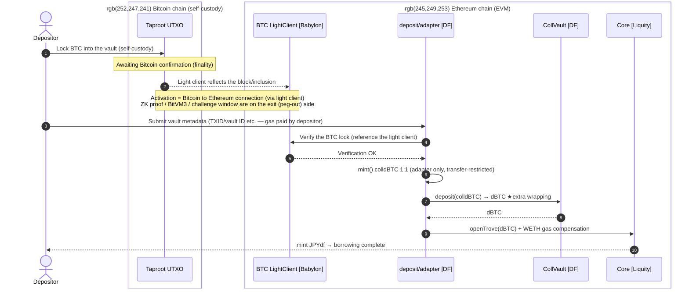
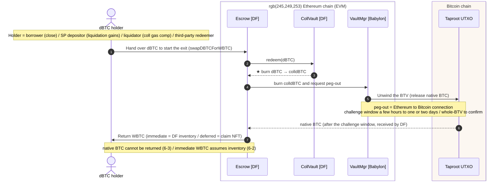
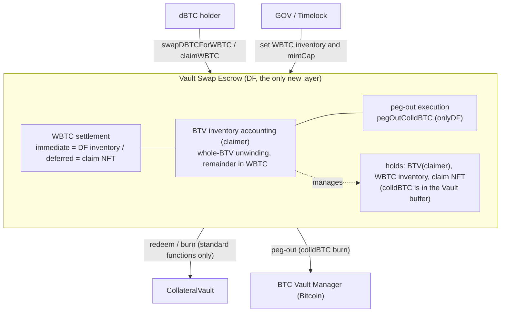

# BTV Collateral Integration

> **Positioning**: A design note for integrating Babylon's `BTV` (a self-custodial Bitcoin vault) as JPYdf's BTC collateral (Branch 4 `dBTC`). The approach is to **leave the existing dToken / CollateralVault unchanged and absorb the Babylon integration into a single `Vault Swap Escrow` layer**. Proposal stage (to be finalised through alignment with Babylon and testnet verification). Canonical sources: [`Parameters.md`](../../../../Parameters.md) (branches and Day-1 values) / the Japanese [Collateral Parameter Policy](../../../../../jp/protocol/product/policies/Collateral-Parameter-Policy.md) §2.4 (inert-branch acceptance criteria) / [`Product-Overview.md`](../../../product/Product-Overview.md) (ARCH / SYS-*) / [`Liquity-v2-Core-Spec.md`](../../../product/spec/Liquity-v2-Core-Spec.md) (liquidation and redemption) / [`dToken.md`](../../../product/spec/dToken.md) and [`CollateralVault.md`](../../../product/spec/CollateralVault.md).

## Background and objective

**Objective**: Enable native BTC on Bitcoin to be collateralised **without bridging or wrapping**, so that JPYdf can be borrowed against it (Liquity v2 Core cannot handle BTC on another chain directly). Babylon's **Trustless Bitcoin Vaults (TBV)**, which makes this possible, is a protocol that collateralises native BTC on the EVM **while keeping it self-custodial**, and has already been implemented as **TBV × Aave v4**. This document takes that as a reference and designs a DF version that **swaps the lender from Aave to JPYdf (a Liquity v2 fork)**. Correspondences: Aave v4 ↔ JPYdf, `vaultBTC` ↔ `colldBTC` / `dBTC`, `Vault Swap Contract` ↔ `Vault Swap Escrow`.

| Term | Meaning (source = the reference Gists at the end) |
| --- | --- |
| Babylon | The party that provides TBV. Operates the BTC Vault Manager, keeper and registry. |
| TBV (Trustless Bitcoin Vaults) | A protocol that collateralises BTC on the EVM while keeping it self-custodial, without bridging or wrapping. |
| **BTV** | A single TBV vault. **1 UTXO that locks native BTC into a Bitcoin Taproot, indivisible and non-fungible**. Created by peg-in, unwound by peg-out (which carries a challenge window, i.e. **the exit side**; the challenge window does not apply to entry: §3-4). Production values to be confirmed. |
| **colldBTC** | An ERC-20 claim on a BTV holding (equivalent to `vaultBTC` in TBV × Aave, 1:1 with the vault). The peg-out right to native BTC is permissioned. |
| **dBTC** | A standard dToken with `colldBTC` as its underlying. An 18-decimal ERC-20 that JPYdf Core treats as collateral. |
| **Vault Swap Escrow** | An escrow that converts collateral seized in liquidation or redemption into WBTC (equivalent to the `Vault Swap Contract` in TBV × Aave). The only layer DF newly builds in this document. |

**Structural difference from the Aave model (a premise for what follows)**: TBV × Aave uses **partial liquidation**, where the liquidator seizes the collateral vault directly, and because the vault is indivisible, the portion seized beyond the target (over-seizure) is returned to the borrower in WBTC. JPYdf, by contrast, uses **Liquity v2, i.e. full liquidation (no partial liquidation)**, where the seized collateral goes not to the liquidation keeper but to the **SP depositors**. This difference separates the liquidation and third-party redemption paths (§4) from the design of the SP depositors' exit (dBTC to WBTC) (§6-1, §6-2).

---

## 1. Design overview

| Provider | Components |
| --- | --- |
| Babylon | • BTC Vault Manager (BTV creation, unwinding, challenge, applications registry)<br>• `colldBTC`, the native BTC redemption allowlist |
| DF (required) | • `dBTC` (**a standard dToken**, no new implementation)<br>• **`Vault Swap Escrow` (the only new layer)**, which absorbs the entire Babylon-integration implementation<br>• Note: `CollateralVault` is **used as standard, unchanged** (not extended) |

### 1-1. Provided by Babylon (existing)

- `BTV`: a self-custodial vault of native BTC locked into a Taproot script on Bitcoin. Corresponds to 1 UTXO, indivisible and non-fungible.
- `BTC Vault Manager`: Babylon's core contract. Manages BTV creation (peg-in), collateral withdrawal (peg-out), challenge, and the registry of integrated applications.
- native BTC redemption allowlist: a permissioned list that restricts which parties can unwind native BTC (BTV). **DF (its Escrow contract) becomes a member.**
- `colldBTC`: an ERC-20 of a `BTV` holding. A claim on native BTC (BTV). **Held by DF-side contracts (Vault / Escrow)**, and the right to burn it and withdraw native BTC is permissioned (DF only).
    - ⚠️ **To confirm (Babylon)**: whether `colldBTC` is fungible within a pool (any `colldBTC` can claim any amount against pooled BTV). If it is non-fungible (bound to a specific BTV), the Escrow must hold pooling / inventory management (§5). Note that the Aave governance TBV proposal explicitly describes `vaultBTC` as a "transfer-restricted ERC-20 (restricted to allowlisted destinations)", so allowlist restriction is more likely than free fungibility.

### 1-2. DF development (required)

- `dBTC`: the BTC version of a dToken. **Uses the standard dToken implementation as is** (no new logic). The `CollateralVault`'s underlying is `colldBTC`, linked at `1 colldBTC = 1 dBTC` (with decimals adjustment). To Core it is an ordinary 18-decimal collateral ERC20.
- **`Vault Swap Escrow` (the only new set of contracts)**: absorbs all Babylon-specific implementation.
    1. Conversion of `colldBTC` ⇄ native BTC ⇄ WBTC (including permissioned BTV unwinding).
    2. Providing a `dBTC → WBTC` exit (for parties that received `dBTC` through liquidation gains or third-party redemption).
    3. WBTC settlement methods: **immediate** (DF inventory) / **deferred** (a claim Token/NFT in Withdraw Request form, after Babylon's challenge period).
    4. (Optional) trustless return of the profit from selling native BTC (§6-1, §6-2).
    - `colldBTC` is custodied in the standard `CollateralVault` buffer (1:1 with dBTC). What the Escrow holds internally is only the Babylon-specific items (the set of BTVs on which it is the claimer, pending peg-outs, WBTC inventory, claim NFTs); nothing is added to the Vault (holding and wiring details in §5).
- Note: `CollateralVault`: **used as standard, unchanged**. The Escrow calls only the existing public functions `deposit(colldBTC) → mint dBTC` / `redeem(dBTC) → colldBTC` / `burn`. **No** per-collateral branching, new functions, or pending-redemption pool are added.

---

## 2. Architecture (layers and direction of dependency)

```
┌─ 🔵 Liquity Core (unchanged) ───────────────────────────────────────────────────┐
│  borrow / SP / liquidation / redemption all treat dBTC as an IERC20              │
│  liquidation: collateral itself → SP depositors (offset) / redistribution / surplus │
│              keeper gets only trigger + gas compensation                          │
└───────────────┬──────────────────────────────────────────────────────────────────┘
                │ dBTC (public, 1:1, anyone can hold)
┌─ 🟢 dToken(dBTC) + 🟢 CollateralVault (standard, unchanged) ─────────────────────┐
│  underlying = colldBTC. deposit(colldBTC)→mint / redeem(dBTC)→colldBTC            │
└───────────────┬──────────────────────────────────────────────────────────────────┘
                │ ↑ Escrow only calls the Vault's standard public functions (deposit/redeem/burn)
┌─ 🟢 Vault Swap Escrow = the only new layer (absorbs all Babylon-specific logic) ──┐
│  exit : dBTC →[Vault.redeem]→ colldBTC →[DF permissioned]→ native BTC → WBTC      │
│         (immediate = DF inventory / deferred = claim NFT, Withdraw Request)       │
│  entry: native BTC/BTV → colldBTC →[Vault.deposit]→ dBTC                          │
│  colldBTC held in the Vault buffer / Escrow holds BTV(claimer), WBTC, claim NFT   │
└───────────────┬──────────────────────────────────────────────────────────────────┘
                │ permissioned BTV unwinding (DF only)
        Babylon: BTV(self-custody) → colldBTC(DF-only claim)
```

- **Invariant layers (unchanged)**: 🔵 Core / 🟢 dToken(dBTC) / 🟢 CollateralVault. Core treats `dBTC` as an ordinary collateral ERC20 and is unaware of dToken / Underlying / `colldBTC` (see [`Liquity-v2-Core-Spec.md`](../../../product/spec/Liquity-v2-Core-Spec.md)). CollateralVault is the standard wrapper for `colldBTC` ⇄ `dBTC`.
- **New layer**: 🟢 `Vault Swap Escrow` (one layer). It sits **between** `dBTC` holders and the `CollateralVault` (on the exit path) and absorbs Babylon-specific processing.
- **Direction of dependency (one-way)**: Core / CollateralVault / dToken **do not know about or call** the Escrow. The only direction is the Escrow calling CollateralVault's standard public functions. The same "outer auxiliary layer" as a Zapper.
- This satisfies ARCH-001 (Core parity) / ARCH-002 (separation of responsibilities) / ARCH-004 (changes confined to the outside).

---

## 3. Collateralising BTC (entry)

Entry spans **two chains, Bitcoin and Ethereum**. The crossover is not a bridge but a **collateral activation in which the depositor submits the vault metadata and the contract verifies the BTC lock via a Bitcoin light client** (no wrapping or bridging; litepaper §5/§9). At minimum it requires "1 Bitcoin tx (awaiting confirmation) plus 1 EVM tx (submit → verify → mint)", so it is not instantaneous.

### 3-1. Sequence diagram (who calls which contract)

The `box` frames are the processing chains (left = Bitcoin / right = Ethereum), the lifelines are each contract (with their owner), solid `->>` lines are calls and dashed `-->>` lines are returns. ② is the connection between the two chains, i.e. collateral activation.



- Ownership: Babylon = `BTC LightClient`, `colldBTC` / DF = `deposit/adapter` (Vault Swap Escrow), `CollVault` (CollateralVault), `dBTC` / Core = `BorrowerOperations` / `JpydfToken`. ★ = a DF-specific extra wrapping (Aave collateralises `vaultBTC` directly). Permissions and trust for each step are in §3-2; confidence and items to confirm are in §3-4.

### 3-2. Step detail (party, chain, permissions)

| # | Chain | Party | Action | Contract / artefact | Notes on permissions and trust |
| --- | --- | --- | --- | --- | --- |
| 1 | Bitcoin | Depositor | Creates the Taproot vault and fixes the **set of claimers that can peg out** and the challenger set | Bitcoin Taproot script | The claimer set is **fixed at creation and cannot be added to later**. DF Escrow must be put into the claimer set here |
| 2 | Bitcoin | Depositor | Locks native BTC into the UTXO (the key is held by the owner, i.e. self-custody, with no third-party custody) | `BTV` = 1 UTXO | Cannot be split or rehypothecated |
| 3 | Bitcoin | - | Awaiting Bitcoin confirmation (finality) | - | Depends on Bitcoin's finality |
| 4 | Ethereum | **Depositor** (a frontend/relayer may act on their behalf) | Submits vault metadata (TXID/vault ID etc.); the contract verifies the BTC lock | `deposit/adapter` + `BTC light client` | Entry is recognised by **light client (SPV) verification**; gas paid by the depositor. **No challenge window** (ZK/BitVM3 are on the exit side). Source: litepaper §5/§9 |
| 5 | Ethereum | DF adapter | **Mints `colldBTC` 1:1** against the vault record | DF `Vault Swap Escrow` / adapter | `colldBTC` is transfer-restricted; mint/burn only by the adapter → **users do not hold it** |
| 6 | Ethereum | DF adapter | `deposit(colldBTC)` → **mints `dBTC`** | `CollateralVault` (standard, unchanged) | ★A step not present in Aave (Core only collateralises a standard 18-decimal dToken) |
| 7 | Ethereum | position account | Opens a Trove with `dBTC` as collateral (plus WETH gas compensation) | `BorrowerOperations.openTrove` | In self-borrow the depositor's EOA owns it. WETH must be sourced (§6-4) |
| 8 | Ethereum | Core | **Mints JPYdf** at the borrower's chosen interest rate | 🔵 Liquity Core | Core's JPYdf issuance substitutes for Aave's "borrow from the Hub" |

> In practice, **steps 4 to 8 can be aggregated into a single EVM tx by the deposit/adapter (or a Zapper)** (litepaper §9: the deposit contract even calls the lending protocol's functions; the experience is "deposit BTC and receive JPYdf"). Steps 1 to 3 (the Bitcoin side), however, cannot be aggregated because they are processed on a separate chain.

### 3-3. Differences from the Aave version (three DF-specific points)

1. **There is one extra wrapping step**: Aave uses `vaultBTC` **directly** as collateral, whereas DF inserts `colldBTC →[CollateralVault.deposit]→ dBTC` before handing it to Core (Core only knows `dBTC`).
2. **Even at entry, `colldBTC` never reaches the user**: because it is transfer-restricted, the adapter (which is on the allowlist) receives it, and what the user holds is `dBTC` (freely transferable), or, via a Zapper, a Trove plus JPYdf from the outset.
3. **Fixing the claimer set constrains entry**: the peg-out parties are fixed at vault creation and cannot be added later. This makes it essential to "**designate DF Escrow as a claimer at the moment the vault is created**", which creates design pressure for BTV creation to be adapter-led.

### 3-4. Verified / to confirm

- ✅ **Verified (public sources, see end)**: ① Locked into a Taproot UTXO under self-custody; 1 vault = 1 UTXO, cannot be split or pooled. ② The claimer set (those who can unwind native BTC) and challenger set (those who can stop a fraudulent claim by objecting within the challenge window) are **fixed at vault creation and cannot be added later**, and those outside the set cannot peg out. A claim requires a ZK/SNARK proof of the host-chain (EVM) event, and invalid claims are blocked by BitVM3 (if the depositor is included as a claimer, self-redemption is possible). ③ **Entry is recognised by a Bitcoin light client (SPV)** that verifies the BTC lock, then vault record → mint (initiated by the depositor's submission, with gas also paid by the depositor; litepaper §5/§9). **Entry needs no ZK/BitVM3/challenge window.** ④ The adapter mints a **transfer-restricted ERC-20** 1:1 (`vaultBTC`, which is `colldBTC` in this document), and mint/burn is only by the adapter. ⑤ The challenge window (configurable, "a few hours to one or two days") is a mechanism on the **exit (peg-out) side** (it does not apply to entry).
- ⚠️ **To confirm (not in public information / assumptions in this document)**: the identity of the co-signer (only the owner, or is a Babylon operator also involved) / the **light client implementation for entry** (on-chain, or off-chain plus a verification contract; litepaper §9 allows both) / **the challenge window vs the total time to receive native BTC** (the challenge window is configurable at a few hours to one or two days: official blog; the total time to receive native BTC is about 3 days in the Aave model: confirmed directly by the Babylon team, and the design Gist agrees; the two are different, and production values are to be confirmed) / the fungibility and unwinding granularity of `colldBTC` (§1-1) / the conditions and procedure for DF Escrow to enter the claimer set (§7) / the handling of decimals for `BTC 8dec → colldBTC → dBTC 18dec` / **whether Babylon can register DF's `CollateralVault` and `Vault Swap Escrow` on the colldBTC transfer allowlist** (if not, the wiring must be reconsidered).
- The remaining entry-side issues (who creates the BTV, and how `colldBTC` is put into the Vault) will be worked out in the Next Action.

---

## 4. The dBTC burn flow (liquidation, third-party redemption, normal withdrawal) (exit)

Exit is the two-chain process in the reverse direction of entry. **The substance of the "dBTC burn" is `CollateralVault.redeem(dBTC)`** (standard dToken redemption, i.e. burning `dBTC` and releasing the underlying `colldBTC`). Because `colldBTC` is transfer-restricted, **it can only be burned via the allowlisted `Vault Swap Escrow`** (the inverse of entry). The party that received `dBTC` obtains the exit `dBTC → colldBTC → (peg-out) → native BTC → WBTC` through the Escrow (who holds the `dBTC` follows the four paths below).

**There are four paths to the party that burns `dBTC`** (all converging on "bring `dBTC` to the Escrow and burn it"):

- **Normal withdrawal**: the borrower closes the Trove (repaying JPYdf), and the collateral `dBTC` is returned.
- **Liquidation gains (SP depositors)**: **most** of the `dBTC` seized in a liquidation is granted to the **SP depositors** (offset; any SP shortfall is redistribution; any excess is returned to the original borrower as surplus). Withdrawn via `withdrawFromSP` / `claimAllCollGains`.
- **Liquidator (keeper)**: the `msg.sender` that triggered the liquidation **receives, in dBTC**, the **collateral gas compensation** (0.5% of collateral, capped at 1,000 dBTC, i.e. `min(coll/200, 1_000e18)`), in addition to the fixed WETH gas compensation of 0.0375 ETH (`TroveManager._sendGasCompensation` → `activePool.sendColl`). The amount is small, but as a dBTC holder it too joins the Escrow exit flow.
- **Third-party redemption**: the redeemer **receives `dBTC` directly from Core** via `CollateralRegistry.redeemCollateral` (an IERC20 transfer only; Core does not know about the Escrow).

### 4-1. Sequence diagram (who calls which contract)

The `box` frames are the processing chains (left = Ethereum / right = Bitcoin), the lifelines are each contract, solid `->>` lines are calls and dashed `-->>` lines are returns. The peg-out at ⑤⑥ is the connection between the two chains, and ★ is the dBTC burn.



- Ownership: DF = `Escrow` (Vault Swap Escrow), `CollVault` (CollateralVault), `dBTC` / Babylon = `VaultMgr` (BTC Vault Manager), `colldBTC`, `BTV`. The origin of liquidation and redemption is Liquity Core. Permissions and trust for each step are in §4-2; confidence and items to confirm are in §4-3.

### 4-2. Step detail (caller → executing contract, chain, permissions)

| # | Chain | Party | Action | Executing contract | Notes on permissions and trust |
| --- | --- | --- | --- | --- | --- |
| 1 | Ethereum | dBTC holder | Starts the exit with `swapDBTCForWBTC(dBTC)` (sends dBTC to the Escrow) | `Vault Swap Escrow` | Anyone (dBTC is freely held and freely transferred) |
| 2 | Ethereum | Escrow | `redeem(dBTC)` → **burns dBTC** and receives colldBTC | `CollateralVault` (dBTC burn) | ★dBTC burn. colldBTC can only be received by allowlisted destinations → holders cannot redeem directly; the Escrow is required |
| 3 | Ethereum | Escrow / DF | Burns colldBTC and requests peg-out | `BTC Vault Manager` (peg-out) | Permissioned (premised on DF being in the claimer set at vault creation, paired with §3 entry) |
| 4 | Bitcoin | DF (claimer) | Unwinds the BTV → releases native BTC | Taproot UTXO / Babylon | Challenge window a few hours to one or two days; **in whole-BTV units** (remainder settled in WBTC) |
| 5 | Ethereum | DF / Escrow | native BTC → WBTC, returned to the holder | `Vault Swap Escrow` (WBTC settlement) | **Immediate = DF inventory** / **deferred = claim NFT** (after the challenge window) |

> **The delay can have two layers**: (a) when the standard dToken redeem buffer is insufficient, a `WithdrawRequest` (at the colldBTC level, VAULT-FR-006), and (b) the Bitcoin peg-out challenge window. Immediate WBTC return is premised on **DF's WBTC inventory** (§6-2). Because `BTV` cannot be partially unwound, it is unwound in whole units and the remainder settled in WBTC (§6-3).

### 4-3. Verified / to confirm

- ✅ **Verified**: `dBTC` burn = `CollateralVault.redeem` (standard dToken; the dToken layer is permissionless) / because `colldBTC` is transfer-restricted, **the Escrow is required** / peg-out is **permissioned, with a challenge window, in whole-BTV units** (the Babylon TBV / Aave version spec) / a `dBTC` burn **reduces supply 1:1 with `colldBTC`** (consistent with SYS-INV-002) / the liquidator receives the fixed WETH gas compensation plus **the collateral gas compensation (0.5% of collateral, capped at 1,000 dBTC) in dBTC** (`TroveManager` L380/480/547, checked against the actual code).
- ⚠️ **To confirm (claiming set / arbitrageur)**: register DF as an arbitrageur (claimer) on the native BTC redemption allowlist. Further, including fallback third-party arbitrageurs, they must be **registered into the claiming set in bulk at vault creation** (no later additions). This changes the premise of entry (§3-2). To be coordinated with Babylon (§5-4).
- ⚠️ **To confirm**: the **claimer procedure and proof submitter** for peg-out (the same root as fixing the claimer set at §3 entry) / the **definitive value of the challenge window** / the **funding source for immediate WBTC settlement** (§6-2) / the **redeem ratio when backing < 1** (how `backingRatio` is applied when `colldBTC < dBTC`) / whether a normal close → redeem is supported on the BTC branch on Day 1.

Economic viability (whether the redeemer can realise ¥1 worth via `dBTC → WBTC`), the constraint that native BTC cannot be returned, and immediate WBTC liquidity are the Key Issues in §6-1 / §6-3 / §6-2.

---

## 5. Vault Swap Escrow design

The `Vault Swap Escrow` is the layer that **absorbs all** Babylon-specific processing (`colldBTC` ⇄ native BTC ⇄ WBTC conversion, permissioned BTV unwinding, and immediate / deferred WBTC settlement) (boundary and direction of dependency in §2). What the Escrow holds internally is **the set of BTVs (claimer), pending peg-outs, WBTC inventory, and claim NFTs**. `colldBTC` itself is stocked in the standard `CollateralVault` buffer (1:1 with dBTC), and the Escrow only passes it through temporarily at the entry/exit boundary (so the Vault too must be registered on the `colldBTC` transfer allowlist).

### 5-1. Structure diagram (responsibilities, held assets, call boundary)

The callers (`dBTC` holders, GOV) / the Escrow's internal responsibilities and held assets / the externals the Escrow calls (`CollateralVault`, `BTC Vault Manager`).



### 5-2. Responsibilities, settlement, interface

- **Two forms of WBTC settlement** (to decide, §6-2): ① **Immediate**: DF holds WBTC inventory and returns WBTC immediately when `dBTC` is brought in (inventory = critical path). ② **Deferred**: a claim Token/NFT is issued and exchanged after `colldBTC → native BTC → WBTC` (the challenge period) (in Withdraw Request form).
- **Which to choose is the `dBTC` holder's decision**: immediate means paying a haircut of about 1% to get WBTC right now (the haircut is the arbitrageur's share for taking about 3 days of risk). Deferred avoids the haircut and comes close to the full amount, but the holder themselves bears about 3 days of challenge risk.
- **BTV inventory management**: the Escrow holds, as claimer, the set of BTVs that back the `dBTC` supply, and unwinds whole BTVs for peg-out requests (remainders settled in WBTC).

| Responsibility | Function | Internal behaviour | Permission |
| --- | --- | --- | --- |
| Accept exit | `swapDBTCForWBTC(dBTC, receiver)` | `CollateralVault.redeem` (dBTC burn) → immediate WBTC or claim issuance | Anyone |
| Deferred exchange | `claimWBTC(claimId)` | Exchange the claim NFT for WBTC | Claim holder |
| peg-out | `pegOutColldBTC(amount)` | colldBTC burn → unwind BTV via `BTC Vault Manager` → native BTC | **onlyDF** |

Interface sketch (illustrative, not a final specification):

```solidity
interface IVaultSwapEscrow {
    function swapDBTCForWBTC(uint256 dBTCAmount, address receiver)
        external returns (uint256 wbtcOut, uint256 claimId);   // immediate WBTC or claim
    function claimWBTC(uint256 claimId) external returns (uint256 wbtcOut); // deferred settlement exchange
    function pegOutColldBTC(uint256 colldBTCAmount) external onlyDF;        // colldBTC burn → unwind BTV
}
```

> The Escrow only calls the standard functions of `CollateralVault` (`redeem` / `burn`). It does not touch the code of `CollateralVault` / `dToken` at all.

### 5-3. To decide / to confirm

- 🔧 **To decide**: the WBTC settlement method (immediate / deferred) and the party that underwrites the inventory (the critical path in §6-2). A dynamic mintCap according to WBTC inventory is also an option.
- ⚠️ **To confirm**: if `colldBTC` is **non-fungible** (bound to a specific BTV), the Escrow needs an explicit **pooling mechanism** (§1-1). If fungible, simple inventory accounting suffices.
- ✅ **Fixed (design boundary)**: Core / Vault / dToken unchanged (§2). The behaviour of `dBTC` burn and peg-out is consistent with §4.

---

### 5-4. LLV / arbitrageur path (proposal, reflecting discussion with the Babylon team)

> This section is the direction agreed in discussion with the Babylon team. It is a proposal rather than a final specification, with items to decide/confirm left at the end.

In Babylon's TBV × Aave, the liquidator's exit is served by **LLV (liquidation liquidity venues)** and a permissioned **arbitrageur** that pegs out native BTC. JPYdf incorporates this as follows.

- **Own LLV**: this document's `Vault Swap Escrow` doubles as JPYdf's LLV. The haircut for immediate WBTC is **1%**.
- **DF becomes one of the arbitrageurs**: DF (its Escrow) is to be registered on the native BTC redemption allowlist (the claiming set). Because the claimer is **fixed at vault creation and cannot be added later**, the premise is that at entry (§3-2), at every vault creation, **DF and fallback third-party arbitrageurs** are put into the claiming set (§4-3, to confirm).
- **Sourcing immediate WBTC**: DF covers the immediate payout by **borrowing WBTC from Aave v3**. Because the current `CollateralVault` / `Strategy` does not assume borrowing, **funds (DF's capital)** may be needed to post Aave v3 collateral. The volume that can be handled is rate-limited by this collateral amount (this is the JPYdf version of the Babylon team's question of how much capital the arbitrageur can allocate. The Aave Hub is a short-term buffer that smooths the immediate front, while the capital locked for 3 days is provided by the arbitrageur, i.e. DF).

The path splits according to whether the `dBTC` provider wants immediate WBTC.

**If immediate WBTC is wanted (1% haircut)**
- First path: DF, as arbitrageur, pegs out native BTC and **funds the Aave v3 borrowing interest out of the haircut (1%)**. The holder immediately receives the equivalent of 0.99.
- If DF cannot execute: a third-party arbitrageur executes it, and **the third party takes the haircut (1%)** (immediate settlement requires someone to front capital, so whoever fronts it takes the 1%).

**If waiting 3 days (full value)**
- First path: DF, as arbitrageur, pegs out native BTC and **pays the full value to the redemption token holder** (since the holder who chose the delay bears the 3-day risk, no haircut is applied).
- If DF cannot execute: a third-party claimer is asked to peg out, and **DF bears that party's service fee (smaller than 1%, for execution plus challenge risk)** and gives the holder the full value. DF guarantees that "deferred = full value".

### 5-4-1. To decide / to confirm

- 🔧 **To decide**: the source of collateral for the Aave v3 borrowing. Either (a) DF's own treasury (clean but requires DF capital), or (b) rehypothecation of branch underlying (the Aave V3 supply of branches 0/1) (zero additional funds, but it affects branch isolation and the dToken backing SYS-INV-002/004, and is premised on conservative operation plus risk-governance approval).
- ⚠️ **To confirm (peg floor)**: a **third-party redeemer** that chooses immediate settlement bears the 1% haircut, lowering the redemption peg floor by about 1%. Unlike liquidation, there is no 5% penalty and it cannot self-finance, so it must be designed together with the redemption fee (§6-1).
- ⚠️ **To confirm (claiming set)**: whether DF plus fallback third-party arbitrageurs (e.g. Babylon's five firms) can be **registered into the claiming set at vault creation**. Because there are no later additions, this directly affects the entry requirements (to be coordinated with Babylon).

---

## 6. Key Issues (open)

> **6-1 to 6-3 derive from a common root.** The root is "the only exit for `dBTC` is `dBTC → WBTC` via the Escrow (it cannot be returned as native BTC, and the conversion entails a **discount, a challenge window, and a WBTC funding source**)". From this come three questions on different axes: **6-1 = peg economics** (whether arbitrage works) / **6-2 = funding and liquidity** (whether immediate WBTC can be provided, a premise of 6-1) / **6-3 = the asset-nature constraint** (it stops at WBTC, unavoidable). 6-1 and 6-2 are a paired **Day-1 gate**; 6-3 is an accepted constraint plus mitigation.

### 6-1. Risk that third-party redemption arbitrage fails to hold and the peg floor collapses (economic axis)

- Redemption is the mechanism that creates JPYdf's peg floor by having arbitrageurs execute "1 JPYdf = ¥1 worth of collateral" **only when it is profitable**. For it to hold, the received collateral must be **immediately convertible** into ¥1 worth.
- On the BTC branch the received item is `dBTC`, and the only way to realise value is the Escrow's `dBTC → WBTC`. On top of that come a **discount** (compensation for DF's asynchrony and WBTC inventory risk; in implementation about 1%, the arbitrageur's share for taking about 3 days of risk, as in the Babylon LLV model) plus a **delay** (the peg-out challenge window), and once `JPYdf's discount margin < WBTC discount + redemption fee`, arbitrage becomes loss-making → **redemption does not happen, i.e. the peg floor disappears**. Because JPYdf debt is common across all branches (**the isolation limit of SYS-INV-004**) and redemption is apportioned across all branches, a failure on the BTC branch **can drag down the peg of JPYdf as a whole**.
- → Before activation, define a **redemption path on which arbitrage runs profitably** = **bounded discount (a fixed haircut cap) × synchronous settlement (immediate WBTC)** (the floor falls slightly to around ¥(1 − haircut − fee) but "remains as a floor"). A **Day-1 gate** on a par with `SYS-RISK-001` / `SYS-RISK-002`. Its funding source **depends on 6-2**.

### 6-2. The WBTC funding source that supports immediate dBTC → WBTC settlement (liquidity axis, critical path)

- Both 6-1's "synchronous settlement (immediate WBTC)" and the liquidation exit presuppose **WBTC inventory that the Escrow can hand over immediately**. The design points are: the provider and size of the inventory, the settlement method (immediate vs deferred claim), **who bears the underwriting risk of the challenge window (several days)**, and a **dynamic mintCap** according to WBTC inventory.
- In the Aave integration it is Aave itself that hands WBTC to the liquidation layer. In JPYdf, **DF (Escrow / treasury) bears this funding provision** (the critical path for an emerging protocol). **This is the substance that satisfies 6-1's Day-1 gate.**
- ⚠️ Proposal (§5-4): DF covers immediate WBTC by **borrowing from Aave v3**, recovering the borrowing interest via the haircut (1%) (liquidation absorbs it through the 5% penalty; redemption cannot self-finance, and the resulting fall in the peg floor must be accounted for in the design). DF's burden shifts to "the collateral posted on Aave v3", and the volume that can be handled is rate-limited by that collateral amount. Details in §5-4.

### 6-3. The exit stops at WBTC and cannot return to native BTC (asset-nature constraint, unavoidable)

- When a BTV is unwound through liquidation or third-party redemption, that Trove loses its native BTC, and the remainder (excess collateral, fractions) **can only be returned in WBTC** (an **unavoidable constraint** owing to `BTV` not being partially unwindable, not a "problem that design can remove" like 6-1/6-2).
- Mitigation is in the direction of lowering the probability of liquidation / redemption through conservative LTV, interest-rate adjustment, and topping up collateral (a self-borrow Trove plus an off-chain keeper, or Liquity-native delegation / batch manager). Return to native BTC is an accepted constraint that is not guaranteed.

### 6-4. Sourcing the WETH gas deposit

- Liquity v2 requires, at each Trove open, prepayment of `ETH_GAS_COMPENSATION` (a fixed gas compensation denominated in WETH; returned on close / paid to the keeper on liquidation). The "deposit only BTC" UX (a Zapper) needs to build in **WETH sourcing**.

---

## 7. Next Action

- Hypothesis testing on testnet (Sepolia) (Aave-based only; vault creation → borrow → repay → withdraw). Because the GitHub for `BTV` itself is not public, this is the best place to check actual behaviour.
- Confirmations with the Babylon team (after aligning within the DF team):
    - **The fungibility / unwinding granularity / challenge period of `colldBTC`** (the items to confirm in §1-1, §5).
    - The conditions and procedure for entering the native BTC withdrawal allowlist.
    - The registry registration requirements (related to `Vault Swap Escrow`).
    - Whether $BABY incentives are possible (reinforcing 6-2).
    - **Who creates the BTV** (the initiative to reliably include DF Escrow in the claimer set at vault creation, since there are no later additions; §3-2).
    - **The vault's co-signer composition** (only the owner, or is a Babylon operator also involved) and **the light client implementation for entry** (on-chain / off-chain plus a verification contract).
    - **Decimals handling** (the conversion and rounding for `BTC 8dec → colldBTC → dBTC 18dec`).
- Work out the economic design of 6-1 (redemption arbitrage) and 6-2 (WBTC funding source).

---

### References / related requirements

- [Aave Governance: Temp Check - Babylon Trustless BTC Vault Integration on Aave v4](https://governance.aave.com/t/temp-check-babylon-trustless-btc-vault-integration-on-aave-v4/24964) (vaultBTC = transfer-restricted, mint/burn only by the adapter, permissioned redemption, Hub/Spoke)
- [Babylon: What is TBV - Trustless Bitcoin Vaults (official docs)](https://docs.babylonlabs.io/trustless-bitcoin-vault/start-here/what-is-tbv/)
- [Babylon: Trustless BTCVault 101](https://babylonlabs.io/blog/trustless-btcvault-101) (the mechanism of peg-in / activation / claimer and challenger sets / a challenge window of a few hours to one or two days)
- [Babylon × Aave Labs partnership announcement](https://babylonlabs.io/blog/babylon-labs-and-aave-labs-partner-to-bring-native-bitcoin-backed-lending-to-aave-v4) (an overview of entry: Taproot UTXO → vault record → adapter → vaultBTC)
- [Babylon: TBV litepaper (PDF, **primary source**)](https://docs.babylonlabs.io/papers/trustless-bitcoin-vaults.pdf): §5 (submit vault metadata → light client verification → collBTC mint) / §9 (the deposit contract is the mint/burn controller and calls the lending protocol). The basis for "entry = light client recognition; ZK/challenge are on the exit side".
- Liquity v2 GitHub: [v2 docs](https://docs.liquity.org/) / [bold](https://github.com/liquity/bold)
- Related requirements and constraints (which this design must satisfy): ARCH-001 / 002 / 004 (Core parity, separation of responsibilities, changes on the outside), SYS-CON-002 (the external interface is only a collateral ERC20 plus price) / SYS-CON-003 (18 decimals), SYS-INV-002 / 003 / 004 (dToken claim consistency, single supply, branch isolation limit), [ADR-001 / 002 / 006](../../../product/architecture/Architecture-Decision-Records.md) (base-parity fork, dToken+Strategy, behaviour on backing impairment), the [Day-1 Parameter Manifest](../../../../Parameters.md) (Branch 4 = dBTC), the [Mainnet Launch Product Decision Record](../../../launch/decisions/Mainnet-Launch-Product-Decision-Record.md) (inert state), the Japanese [Collateral Parameter Policy](../../../../../jp/protocol/product/policies/Collateral-Parameter-Policy.md) §2.4 with the [Inert Branch Activation Runbook](../../../operations/runbooks/Inert-Branch-Activation-Runbook.md), and [`Product-Overview.md`](../../../product/Product-Overview.md) §6.1 (inert activation, and if it cannot be contained, a full redeploy = migration).
