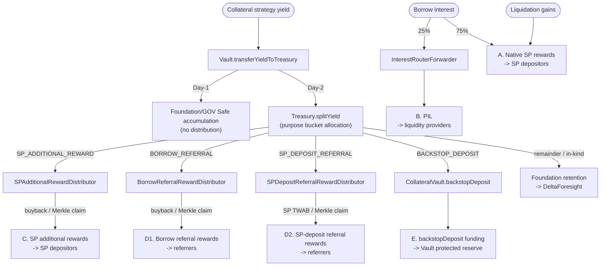

# Protocol Revenue -> User Reward Routes and Allocation

> Support translation. The Japanese source document
> [`documents/jp/protocol/roadmap/policies/Protocol-Revenue-Allocation-Policy.md`](../../../../jp/protocol/roadmap/policies/Protocol-Revenue-Allocation-Policy.md)
> is authoritative if this file conflicts with it.

## 0. Positioning

This document is the source of truth for the routes by which protocol revenue is
returned to users and for the allocation of collateral strategy yield. The
mechanics and implementation details of each route live in the lower-level source
documents listed at the end. This document only fixes the shared budget table:
which purpose receives what portion of collateral strategy yield.

> **Status**: Draft / Day-2 activation scope. The allocation framework is fixed;
> concrete ratios remain TBD as described in §2. Day-1 does not implement
> `Treasury.sol` or the Distributor contracts. Collateral strategy yield is
> retained in the Foundation/GOV Safe, and existing
> `CollateralVault.backstopDeposit` is used manually when backstop repair is
> needed. The purpose-bucket routing in §2 is not active allocation until the
> Treasury / Distributor implementation, tests, audit package, and governance
> approval are complete.

---

## 1. Reward Routes

There are five reward or backing-protection routes. They differ by source of
funds, launch state, and source document.

| Route | Source | State | Source document |
| --- | --- | --- | --- |
| **A. Native SP rewards** | 75% of borrow interest + liquidation gains | Distributed from Day-1 by Core | Core Spec |
| **B. PIL** | 25% of borrow interest | Day-1 aggregates only; distribution is Phase-A | PILAllocator |
| **C. SP additional rewards** | Collateral strategy yield | Day-1 Safe retention; distribution is Day-2 | Treasury |
| **D1. Borrow referral rewards** | Collateral strategy yield | Day-1 measurement only; distribution is Day-2 | BorrowReferralRewardDistributor / Referral-Program-Policy |
| **D2. SP-deposit referral rewards** | Collateral strategy yield | Day-1 unallocated; distribution waits for sJPYdf / wrapper attribution | SPDepositReferralRewardDistributor / Referral-Program-Policy |
| **E. backstopDeposit funding** | Collateral strategy yield | Day-1 Safe retention and manual repair; Day-2 normal bucket / emergency funding | CollateralVault / Treasury |

Routes C, D1, D2, and E use the same source of funds: collateral strategy yield.
Their allocation is controlled by §2. Routes A and B use separate sources of
funds and are outside §2.

---

## 2. Collateral Strategy Yield Purpose Allocation

From Day-2 onward, collateral strategy yield is allocated across the following
five purpose buckets with a total of 100%. Treasury only routes Underlying to
fixed destinations; buyback, Merkle claim, Referral claim, and
protected-reserve accounting are handled by the receiving contracts. Concrete
ratios are TBD and are finalized in [`Parameters.md`](../../../Parameters.md).
Day-1 does not run automatic allocation from this table; active operation is
Safe retention and manual backstop only.

| Purpose bucket | Ratio | Distribution mechanism |
| --- | --- | --- |
| **C. SP additional rewards** | `alpha` | `SPAdditionalRewardDistributor` (buyback + TWAB + cumulative Merkle claim) |
| **D1. Borrow referral** | `beta` | `BorrowReferralRewardDistributor` (buyback + campaign root + cumulative Merkle claim) |
| **D2. SP-deposit referral** | `gamma` | `SPDepositReferralRewardDistributor` (SP attribution source + buyback + TWAB root + cumulative Merkle claim) |
| **E. backstopDeposit funding** | `kappa` | Treasury -> registered `CollateralVault.backstopDeposit` (Underlying in kind, protected reserve) |
| **Foundation retention** | `delta` (remainder) | Underlying sent in kind during `splitYield` |

Allocation discipline:

- **Fixed destinations only**: every Treasury outflow remains within the destination set allowed by `TRSY-INV-001`; no ratio decision introduces an arbitrary recipient.
- **Single budget table**: all uses of collateral strategy yield are assigned in
  one table, so the same yen/token cannot be counted in two purposes.
- **100% total plus minimum Foundation share**: `alpha+beta+gamma+kappa+delta = 100%`,
  and `delta` stays above the hard bound in [`Treasury.md`](../spec/Treasury.md)
  TRSY-INV-002.
- **Unfinalized buckets are 0**: a bucket whose prerequisites are not finalized,
  such as SP-deposit referral, has ratio 0 and is reallocated to other purposes.
- **Prospective changes only**: ratio changes apply only to future `splitYield`
  calls. Already split funds are not reallocated.
- **Referral uses caps**: Referral rewards are variable acquisition spend, not
  guaranteed payouts. They are controlled by budget, partner, and per-wallet caps.
- **Manual distribution stays on the Foundation side**: if Referral is paid
  manually from Safe Wallet, set the corresponding Referral bucket ratio to 0
  and route that amount to Foundation retention. Budget already sent to a
  Referral distributor has no normal path back to the Safe for manual payment.
- **Separate normal and emergency backstop paths**: `kappa` is the normal
  backstopDeposit funding bucket. During backing impairment, Treasury can run
  `emergencyBackstopDeposit` up to the registered Vault shortfall even while
  normal routing to C/D1/D2/Foundation is paused ([Treasury.md](../spec/Treasury.md)
  TRSY-FR-007). Budgets already routed to distributors / Foundation are not
  automatically clawed back to Treasury.

---

## 3. TBD Items

| TBD | Finalization location |
| --- | --- |
| Concrete ratios `alpha/beta/gamma/kappa/delta` | §2 -> [`Parameters.md`](../../../Parameters.md) |
| Referral budget / partner / per-wallet caps | [`Referral-Campaign-Activation-Gate.md`](../../operations/runbooks/Referral-Campaign-Activation-Gate.md) |
| When normal routing restarts after emergency backstop funding | incident policy / governance decision |
| SP-deposit referral attribution | sJPYdf / wrapper design |
| Governance, tax, and accounting owner approval to use collateral yield for Referral | [`Referral-Program-Policy.md`](../../operations/policies/Referral-Program-Policy.md) §7.2 |

Referral source-of-funds routing is specified by Treasury purpose shares.
Borrow Referral reward asset accounting, root funding / cancellation, and
claims are specified by
[`Reward-Distributors.md`](../spec/Reward-Distributors.md).
SP-deposit Referral source gating, reward asset accounting, root funding /
cancellation, and claims are specified by
[`Reward-Distributors.md`](../spec/Reward-Distributors.md).

---

## Related Source Documents

| Source document | Role |
| --- | --- |
| [`../../product/spec/Liquity-v2-Core-Spec.md`](../../product/spec/Liquity-v2-Core-Spec.md) | Native SP rewards and 75/25 interest split |
| [`../../product/spec/PILAllocator.md`](../../product/spec/PILAllocator.md) | PIL liquidity incentive allocation |
| [`../spec/Treasury.md`](../spec/Treasury.md) | `Treasury.sol` purpose routing, registered backstop Vault routing, and Foundation Safe retention |
| [`../../product/spec/CollateralVault.md`](../../product/spec/CollateralVault.md) | `backstopDeposit` / protected reserve / backingRatio |
| [`../spec/Reward-Distributors.md`](../spec/Reward-Distributors.md) | SP additional rewards, Borrow Referral, and SP-deposit Referral accounting, roots, challenge, and cumulative claims |
| [`Referral-Program-Policy.md`](../../operations/policies/Referral-Program-Policy.md) | Referral measurement, attribution, abuse/clawback, frontend, and ledger gates |
| [`Treasury-Safe-Retention-Runbook.md`](../../operations/runbooks/Treasury-Safe-Retention-Runbook.md) | Day-1 Safe retention accounting and Day-2 switch |
| [`Balance-Sheet-Liquidity-Allocation-Policy.md`](../../../contributors/deltaforesight/policies/Balance-Sheet-Liquidity-Allocation-Policy.md) | Company B/S own-fund allocation, which is a separate source of funds |
