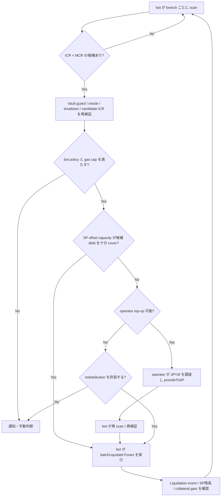

# 清算管理方針

## 位置づけ

本書は JPYdf Day-1 の清算運用方針を定める。清算のオンチェーン挙動は
[`../../spec/Liquity-v2-Core-Spec.md`](../../product/spec/Liquity-v2-Core-Spec.md)、SP / JIT
の用語と実装境界は
[`Liquidation-Backstop-And-JIT-Policy.md`](./Liquidation-Backstop-And-JIT-Policy.md)、
bot の実装範囲は [`Liquidation-Bot-Plan.md`](../../../engineering/plans/Liquidation-Bot-Plan.md)、自己 B/S
の採用額は
[`Day1-Self-BS-Launch-Commitment.md`](../../../contributors/deltaforesight/commitments/Day1-Self-BS-Launch-Commitment.md)、
product 側の branch / SP requirement / planned exposure は
[`Mainnet-Launch-Product-Decision-Record.md`](../../launch/decisions/Mainnet-Launch-Product-Decision-Record.md)、
算定根拠は [`Day1-Self-BS-Initial-Liquidity-Plan.md`](../../../contributors/deltaforesight/commitments/Day1-Self-BS-Initial-Liquidity-Plan.md)
を正本とする。

## 目的・基本姿勢

清算管理の目的は、過少担保 Trove を放置せず、bad debt と JPYdf depeg のリスクを抑えることにある。

DeltaForesight の Liquity v2 core は、過少担保 Trove の債務を branch-local Stability Pool
(SP) で offset し、SP で吸収しきれない債務と担保を同一 branch の active Trove に
redistribute する。Redistribution は protocol safety fallback だが、既存 Trove
ユーザーに予期しない債務増を与えるため、運用上はできるだけ SP offset で処理する。

Day-1 方針は次の順に処理する。

1. 事前 SP 預入で通常サイズの清算を吸収する。
2. Liquidator bot が候補検出、SP capacity 観測、最終 ICR 再検証、`batchLiquidateTroves`
   の dry-run / live 送信を行う。
3. SP capacity が不足する大口清算では、operator が非原子的に JPYdf を調達し、
   対象 branch の SP へ top-up してから清算する。
4. Operator top-up が間に合わない、または損失許容を超える場合は通知し、手動補填、
   redistribution を伴う清算、または一時停止判断を明示的に選ぶ。

## Day-1 実装境界

| 領域 | Day-1 でできること | Day-1 でやらないこと |
| --- | --- | --- |
| Core liquidation | `TroveManager.batchLiquidateTroves(uint256[])` が SP offset と redistribution を実行する | Core は JPYdf 調達、DEX swap、SP top-up を自動化しない |
| Stability Pool | `provideToSP(amount, doClaim)` で JPYdf を預け、清算後に `withdrawFromSP` / `claimAllCollGains` で gain を回収する | `DFStabilityPool` は同一 block の deposit → withdraw を禁止するため、flash loan callback 内で SP 持分をゼロに戻す設計は通らない |
| Liquidator bot | `LiquidationCandidateGetter` scan、`lastZombieTroveId` 補足、SP capacity ログ、Vault guard、gas estimate、policy 判定、任意 live tx 送信 | JPYdf/USDC swap、`provideToSP` 自動実行、atomic bundle、担保売却・会計処理 |
| JIT / backstop | Operator が在庫・self-mint・Uniswap v4 JPYdf/USDC から JPYdf を用意し、非原子的に SP top-up する | Morpho / Aave flash loan を使う Atomic JIT executor は Day-1 未実装 |
| 通知・監視 | bot log / JSON evidence / systemd 等の運用ログを確認する | Slack / Prometheus / private relay は production hardening の後続 gate |

## 初期配分前提

採用する branch、SP requirement、planned exposure は Product Decision Record、会社の SP seed、
self-mint、LP 配分は Self-B/S Launch Commitment から受け取る。JIT capacity は DEX 深度・operator
在庫・tx 実行可否に依存する運用上の見積りであり、`batchLiquidateTroves` が予約・保証するものではない。

## SP / JIT 補充判断

Day-1 の SP 運用は、branch 全体の最低 coverage と、清算 batch ごとの offset coverage を分けて判断する。
稼働中 branch の `mintCap` を引き上げる場合は、反応的な SP top-up ではなく
[`Active-Branch-Cap-Ramp-Runbook.md`](../runbooks/Active-Branch-Cap-Ramp-Runbook.md)
の proactive coverage gate を先に満たす。

| 指標 | Day-1 基準 | 判断 |
| --- | --- | --- |
| Branch SP target | Product Decision Record の branch 別 requirement | `targetSpJpydf` 未達なら public launch しない |
| Batch offset coverage | planned batch debt の 100% | bot の `min_sp_offset_coverage_bps = 10000` を標準。未満なら自動実行せず、JIT top-up / redistribution / pause 判断に送る |
| Stress event readiness | 承認済み SP target + operator JIT | 見積りは Day1 Self-B/S 算定根拠で確認し、JIT を保証値として扱わない |
| SP 集中可能性 | active branch 間の手動再配分 | SP 移動は multisig 経由の別 tx を要するため、watch list で事前に監視する |

post-launch で branch debt が増え、SP target を下回る、または bot の planned batch が
SP offset coverage 100% 未満で skip する状態が継続する場合は、risk owner が次のいずれかを
decision log に残して実行する。

1. SP top-up を行い、target を回復する。
2. JIT funding source と execution owner を明示し、当該 batch の 100% offset coverage を作ってから清算する。
3. redistribution を受け入れる理由、影響 branch、user communication owner を記録したうえで清算する。
4. cap reduction / UI exposure 停止 / campaign 停止により、新規 dToken mint と新規流入の導線を止める。これは branch debt ceiling ではなく、既存 dToken 担保に対する Core の debt increase は MCR/CCR/SCR・価格・shutdown 条件の範囲で継続可能であるため、risk owner は SP top-up / JIT / redistribution / cap ramp 停止のどれで残余リスクを受けるかを decision log に残す。

## 清算判断フロー



## Bot 実行 sequence

```text
[呼び出し主体: bots/liquidator]

1. PriceFeed.fetchPrice()
2. AddressesRegistry.MCR() または branch config の MCR を取得
3. LiquidationCandidateGetter.getLiquidationCandidatesWithLastZombie(...)
4. TroveManager.getCurrentICR(troveId, price) で送信直前の候補を再検証
5. TroveManager.stabilityPool() -> StabilityPool.getTotalJpydfDeposits()
6. total deposits から MIN_JPYDF_IN_SP を控除して SP offset capacity を算出
7. CollateralVault.backingRatio() / pause 状態を確認
8. TroveManager.batchLiquidateTroves(troveIds) の gas estimate を取得
9. execution policy に従い dry-run / skip / live submit を決定
```

現行 bot の収益推定は担保処分を含めず、gas cost を損失として扱う。`protocol-maintenance`
mode では `max_loss_wei_per_tx` と `max_gas_cost_wei` の範囲内で送信できるが、
日次損失 cap は現行 backend の設定項目ではない。

## Day-2 profit-seeking hardening gate

現行 bot は Day-1 の operator maintenance 用であり、外部 keeper が利益目的で安定運用できる
`profit-seeking` liquidator ではない。`profit-seeking` mode は config enum として残すが、
live 起動は collateral disposal と inventory-aware profit model が入るまで fail-closed とする。
次の gate が PR / fork evidence / runbook で揃うまで、UI・docs・partner 向け説明で
「外部清算者が profit seeker として参加可能」と表現しない。

### 必須 profit model

| 項目 | 必須内容 | No-Go 例 |
| --- | --- | --- |
| Gross reward | branch、troveId、entireDebt、entireColl、Core gas compensation、JIT/SP gain、liquidation penalty / collateral gain の推定。P0 では Core gas compensation だけを `liquidatorGasCompensation` として計算し、full profit は blocked のまま扱う | gas compensation だけを full profit として黒字扱いする |
| Disposal route | 受領 dToken / Underlying を JPYdf、USDC、または会計基準 asset へ戻す route、min-out、slippage、quote block | 受領 collateral を spot price で即時現金化できる前提にする |
| Inventory | JPYdf 残高、JIT source、inventory cost、branch ごとの最大投入額 | SP top-up 原資が未定のまま profit を出す |
| Market depth | JPYdf/USDC v4 liquidity、disposal venue depth、max route size、depeg haircut | thin pool で全額を mid price 評価する |
| Gas / relay | base fee、priority fee、stress multiplier、private relay / public mempool policy、failed bundle handling。P0 では base fee / priority fee / max fee と stress multiplier を `gasForecast` として証跡化し、live submit は計画時の gas limit / gas price を tx に固定し、`max_submissions_per_cycle` と `submission_cooldown_blocks` で live tx burst / immediate duplicate send を制限するが、relay / replacement / cancellation / bundle failure handling は blocked のまま扱う | priority fee 急騰や bundle failure を利益計算から外す |
| RPC / oracle | RPC quorum、block lag、read timeout、price freshness、Core が最終使用する `fetchPrice()` との差分。P0 では primary/fallback provider の health、block lag、read timeout を `rpcQuorum` として証跡化し、run daemon の一時 RPC / scan / planning failure / read timeout は scan 前 cursor に戻して poll interval 後に再試行する。gas estimate / gas price / latest block など pre-submit planning read も同 timeout で bound するが、scanner routing / provider voting / price-source quorum は blocked のまま扱う | 単一 RPC / stale price で送信判断する |
| Receipt / accounting | tx hash assignment、submitted tx の from / nonce metadata、receipt status、revert / timeout の JSONL receipt ledger、replacement / dropped の後続照合、gas-only PnL ledger、collateral gain 回収 owner、disposal-aware PnL 台帳 | tx hash 発行だけで成功扱いする |

### Evidence schema

profit-seeking を解禁する PR は、少なくとも次の JSON evidence fields を stable schema として出力する。
private key、raw RPC URL、未公開 Safe nonce、API key は含めない。

| Field | 内容 |
| --- | --- |
| `profitModelVersion` | 収益計算ロジックの version と commit hash |
| `candidate` | branch、troveId、ICR、entireDebt、entireColl、oracle price、quote block |
| `liquidatorGasCompensation` | Core の WETH gas compensation と、SP offset 部分に対する collateral gas compensation。SP/JIT gain・担保売却・inventory cost は含めない |
| `collateralDisposalRoutes[]` | collateral token、route id、venue、minOut、slippageBps、quoteBlock、maxRouteSize |
| `inventory` | `jpydfAvailable`、source、maxInventoryCostWei、branch allocation cap |
| `marketDepth` | JPYdf/USDC v4 depth、sample sell / buy slippage、depeg haircut |
| `gasForecast` | `gas`、`gasPrice`、`baseFeePerGas`、`priorityFeePerGas`、`maxFeePerGas`、`gasCost`、`stressedGasCost`、`stressMultiplierBps` |
| `relayPolicy` | private relay labels、allowPublicMempool、replacement / cancellation policy |
| `rpcQuorum` | `status`、`providerCount`、`requiredAgreement`、`healthyProviderCount`、`maxBlockLag`、`readTimeoutMs`、`observedBlockLag`、provider labels/status。raw RPC URL は含めない。price source agreement は P1 以降 |
| `decision` | expectedGrossProfitWei、expectedNetProfitWei、minProfitWei、skipReason |
| `receipt` | txHash、status、blockNumber、gasUsed、classification、receiptTimeoutSecs、supportedClassifications、escalationOwner。P0 dry-run evidence は `not-submitted` / `planning-only` とし、live submit の outcome taxonomy だけを固定する。live outcome は gas-only PnL ledger に分類と `gasUsed * planned maxFeePerGas` upper bound を残せるが、担保 gain / disposal proceeds / inventory cost を含む full PnL ではない |

### 段階的な有効化

| Phase | 実行範囲 | merge / launch 条件 |
| --- | --- | --- |
| P0 read-only evidence | 清算候補ごとに profit evidence を出すが tx は送らない | historical / synthetic fork で黒字・赤字・thin-SP・route slippage・oracle failure が分類できる |
| P1 operator-approved submit | operator が evidence を確認し、private relay / RPC quorum 下で限定 branch・限定 cap だけ送信 | receipt classification、PnL 台帳、collateral disposal owner、failed tx escalation が揃う |
| P2 external keeper reference | 外部 keeper 向け config / schema / sample route を公開する | permissionless JIT / inventory 方針、rate limit、public docs、support boundary が揃う |

`profit-seeking` の再有効化は、単に config validation を緩める変更ではなく、上記 P0->P1 の
evidence と tests を伴う audit 対象変更として扱う。

## Operator SP top-up sequence

```text
[呼び出し主体: operator / Safe / 別 executor]

1. bot / ops が SP不足と候補 debt を検知
2. operator が JPYdf を用意
   - 既存在庫
   - self-mint 済み JPYdf
   - JPYdf/USDC Uniswap v4 での調達
3. 対象 branch の StabilityPool.provideToSP(amount, false) を実行
4. bot が同 branch を再 scan / 再検証
5. bot または operator が TroveManager.batchLiquidateTroves(troveIds) を実行
6. 清算後、SP depositor が別 tx で withdrawFromSP / claimAllCollGains を実行
7. 受領担保の会計・売却・再 SP 化は別運用で処理
```

`DFStabilityPool` は `provideToSP` 時に `lastDepositBlock[msg.sender] = block.number`
を記録し、`withdrawFromSP` で `lastDepositBlock[msg.sender] < block.number` を要求する。
そのため、Day-1 contract では flash loan callback 内で
`provideToSP -> liquidate -> withdrawFromSP -> flash loan 返済` を完結させる Atomic JIT は成立しない。

## 通知・エスカレーション

Day-1 の最低監視対象:

| カテゴリ | 内容 |
| --- | --- |
| bot 接続障害 | RPC failure、chainId mismatch、config invalid、state file 書込失敗 |
| 清算候補 | branch、troveId、ICR、entireDebt、SP offset capacity、vault guard 状態 |
| 実行判断 | dry-run / skip / submit、gas estimate、loss budget 判定、tx hash / receipt |
| SP 運用 | branch ごとの SP JPYdf 残高、top-up 要否、清算後の collateral gain |

Slack / Prometheus / private relay / RPC quorum は production hardening 項目であり、実装・runbook
が揃うまで「自動通知済み」とは扱わない。

## 将来 Atomic JIT を追加する場合

Atomic JIT は Day-1 の設定追加ではなく、新しい audited executor として扱う。最低限、以下を満たすまで本番へ入れない。

- 資金源を operator inventory / self-mint / DEX swap / flash liquidity のどれにするか明示する。
- `DFStabilityPool` の same-block withdrawal guard と両立する設計にする。flash loan を使う場合、同一 block で SP 持分を引き出せない制約を前提に、返済原資を別途説明する。
- JPYdf/USDC Uniswap v4 route の pool key、hook policy、Universal Router / Permit2 address、min-out、allowance cleanup を freeze する。
- SP deposit と清算対象 branch の一致を on-chain または typed config で検証する。
- loss cap、max gas、min collateral gain、max slippage を必須にする。
- private relay / bundle 失敗時の再送・キャンセル・nonce 管理を runbook 化する。
- fork test で、SP 十分、SP 不足、route slippage、oracle failure、Vault pause、shutdown branch、zombie Trove を含める。

## 参考

- [`Liquidation-Backstop-And-JIT-Policy.md`](./Liquidation-Backstop-And-JIT-Policy.md) — SP / JIT / Atomic JIT の実装境界
- [`Liquidation-Bot-Plan.md`](../../../engineering/plans/Liquidation-Bot-Plan.md) — liquidator backend の実装計画
- [`Mainnet-Launch-Product-Decision-Record.md`](../../launch/decisions/Mainnet-Launch-Product-Decision-Record.md) — Day-1 branch / SP requirement / planned exposure
- [`Day1-Self-BS-Launch-Commitment.md`](../../../contributors/deltaforesight/commitments/Day1-Self-BS-Launch-Commitment.md) — DeltaForesight株式会社の Day-1 B/S 採用額
- [`Day1-Self-BS-Initial-Liquidity-Plan.md`](../../../contributors/deltaforesight/commitments/Day1-Self-BS-Initial-Liquidity-Plan.md) — 算定根拠
- [`Liquidity-Route-Policy.md`](../../product/policies/Liquidity-Route-Policy.md) — JPYdf/USDC Uniswap v4 route policy
- [`../../Parameters.md`](../../../Parameters.md) — 担保 / risk parameter の正本
