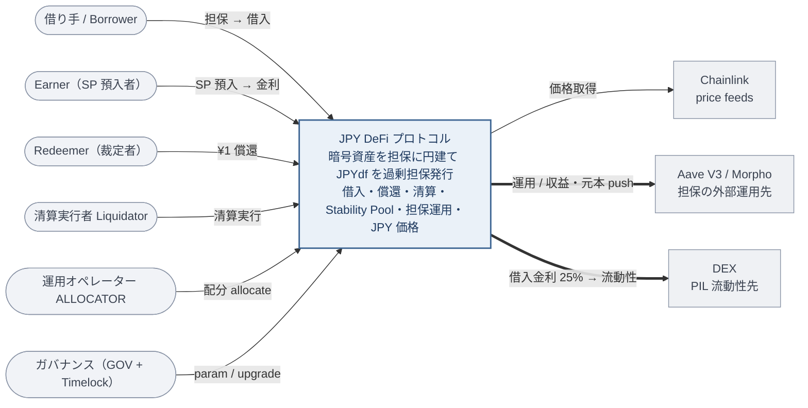
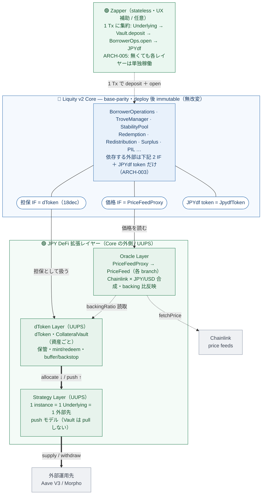

# 📋 Product Overview（システム仕様 / System Specification）

## 0. メタ情報

| 項目 | 値 |
| --- | --- |
| Status | Draft（システムレベル仕様の正本化中） |
| Domain | Protocol |
| Lifecycle | Evergreen |
| Artifact Type | Spec |
| Decision Authority | Protocol Governance |
| Maintainer | DeltaForesight |
| Visibility | Repository |
| Normative Source | 本書（`SYS-FR` / `SYS-CON` / `SYS-NFR` / `SYS-INV` / `ARCH`）。Launch risk gateとarchitecture decisionは別artifact |
| 対象システム | JPY DeFi プロトコル（🔵 Liquity v2 Core ＋ 🟢 dToken / Strategy / Oracle / Zapper） |
| 文書の役割 | **システム要件仕様（SyRS）＋アーキテクチャ記述**。上位要求（投資家向け概要）と下位の component 要件定義（`dToken.md` 等）の中間に位置する正本 |
| 関連ドキュメント | 下位 component spec（§15）/ [Architecture Decision Records](./architecture/Architecture-Decision-Records.md) / [Mainnet Launch Risk Gate](../launch/gates/Mainnet-Launch-Risk-Gate.md) / parameter 定義 [Parameter Catalog](./parameters/Parameter-Catalog.md) / Day1 採用範囲 [Mainnet Launch Product Decision Record](../launch/decisions/Mainnet-Launch-Product-Decision-Record.md) / Day1 値 [Parameters.md](../../Parameters.md) / コア継承仕様 [Liquity-v2-Core-Spec.md](./spec/Liquity-v2-Core-Spec.md) |

> 本書はシステム全体の**要求・制約・原則・不変条件・信頼境界**を扱い、永続 ID（`SYS-FR` / `SYS-CON` / `ARCH` / `SYS-NFR` / `SYS-INV`）を付す。`SYS-RISK`のLaunch gateと`ADR`の決定理由は別artifactを正本とし、§10.1 / §11はその索引だけを持つ。個々の関数の検証可能な約束は下位component spec（`DTKN-*` / `VAULT-*`等）が持ち、本書§13がそれらへトレースする。
> **マーカー**: 🔵 Core（Liquity v2 から base-parity で継承）／ 🟡 Modified（`CORE-MOD-*` 台帳で管理する限定差分）／ 🟢 JPY DeFi Extension（Core の外側に追加する拡張）。

---

## 1. 目的・ビジョン・スコープ

JPY DeFi は、**Liquity v2 をフォークした円建てステーブルコインプロトコル**である。暗号資産・ステーブルコイン等を担保に、円建てステーブルコイン **JPYdf** を過剰担保で発行する。

設計の中核は、**Core を base-parity で継承し、独自機能を Core の外側のレイヤー（dToken / Strategy / Oracle / Zapper）に置く**ことにある。原則・制約の正本は§6（ARCH）/ §7（SYS-FR・SYS-CON）、決定理由は[Architecture Decision Records](./architecture/Architecture-Decision-Records.md)が持つ。

- **Protocol スコープ**: 借入 / 償還（Redemption）/ 清算 / Stability Pool / 担保の外部運用と収益化 / JPY 建てオラクル。`JpydfToken` の bridge-ready 拡張。
- **本書のスコープ外**: 特定 release で有効化する chain / branch / bridge route、ガバナンストークンのトークノミクス詳細、投資家向けの市場分析。
- **特定 release の採用範囲・値**: Day1 の public branch と機能範囲は [Mainnet Launch Product Decision Record](../launch/decisions/Mainnet-Launch-Product-Decision-Record.md)、parameter 値は [Parameters.md](../../Parameters.md)、実際の接続・状態は deploy Manifest / Evidence を正本とする。本書はこれらの可変値を定義しない。

---

## 2. ステークホルダーと関心事

| ステークホルダー | 主な関心事 | 主に触るレイヤー |
| --- | --- | --- |
| **借り手（Borrower）** | 担保を預けて JPYdf を借りる（1 Tx 完結）・清算回避 | 🟢 Zapper → 🟢 dToken → 🔵 Core |
| **dToken 保有者** | dToken を burn して Underlying を引き出す（Buffer 不足時は遅延償還） | 🟢 dToken Layer |
| **Earner（SP 預入者）** | JPYdf を SP に預けて借入金利 75%＋清算益を得る。担保運用益は現行の SP 報酬に含まれない | 🔵 Core (Stability Pool) |
| **Redeemer（裁定者）** | JPYdf を ¥1 分の担保と交換しペグ裁定 | 🔵 Core (Redemption) |
| **清算実行者（Liquidator）** | 担保割れ Trove を清算し実行報酬を得る | 🔵 Core (TroveManager) |
| **運用オペレーター（ALLOCATOR）** | Underlying を Strategy へ配分・収益を Vault へ回収 | 🟢 dToken (Vault) ＋ 🟢 Strategy |
| **ガバナンス（GOV multisig / Timelock）** | パラメータ・whitelist・upgrade・オラクル source の制御 | 全レイヤーの管理操作（GOV 系は原則 Timelock 経由） |
| **governance participant（token 採用時）** | Strategy・Treasury 等の T1 権限は投票へ渡さない | 🔵 Core (PIL) ＋ governance token extension |
| **監査人 / コントリビューター** | 信頼境界・不変条件・Core parity / 差分境界の検証 | 本書 §9 / §10 ＋ component spec |

---

## 3. システムコンテキスト

JPYdf が Core parity / 差分境界を保つために依存する外部は、**コアから見て 2 つの汎用インターフェースだけ**（担保 ERC-20、価格フィード）。独自レイヤーが信頼する外部システムは以下。

> **凡例**: 実線（→）= 利用・呼び出し・価格取得 ／ 太線（⇒）= 資金フロー。**左**＝利用者・経済主体（§2 と対応）／**中央**＝JPY DeFi プロトコル／**右**＝外部システム。

- **信頼する外部システム**: Chainlink、Lido wstETH コントラクト（dwstETH canonical rate）、承認済みの Strategy 運用先、DEX（PIL 配分先）。信頼の強さは §10 を参照。

---

## 4. システム構成要素

### 4.1 トークン

- **JPYdf（円建てステーブルコイン）** — Core の借入トークン。Core の `mint` / `burn` と bridge 用の `bridgeMint` / `bridgeBurn` は供給権限を分離する。
- **🟢 dToken（担保受益権トークン, ERC-20, 18dec）** — ユーザーが預けた Underlying に対する**元本 1:1 の請求権**。Core からは通常の 18dec 担保 ERC-20 として見える。**担保の外部 Strategy 運用益は借り手ではなくプロトコルに帰属し**、借入 UI で開示する。Strategy 毀損時は Vault の backing 比を Oracle が担保価格へ反映する（下方は借り手負担）。Underlying 自体に内在する増価は borrower の担保価値に反映し、外部 Strategy の運用益とは分けて扱う。詳細は [dToken](./spec/dToken.md) / [Oracle](./spec/Oracle.md) / [CollateralVault](./spec/CollateralVault.md)。
- **ガバナンストークン（DFT 仮称・発行未決定）** — 発行を前提としない。要否・方式・時期、拘束投票の権限境界、発行前に満たす G1〜G5 は [Governance Token Design](../roadmap/initiatives/governance-token/Governance-Token-Design.md) を正本とする。

### 4.2 🔵 Liquity v2 コアロジック（base-parity で継承・要約）

> 以下はコアから継承する機構の**読み物としての要約**であり、規範仕様は [Liquity-v2-Core-Spec.md](./spec/Liquity-v2-Core-Spec.md) を正本とする（本書は DF 要件としてコアを再仕様化しない）。

- **Branch（担保別市場）** — 担保ごとに独立した市場。各ブランチが専用の Stability Pool / TroveManager / PriceFeed / 清算パラメータを持ち、リスクが他ブランチに波及しない（隔離の限界は SYS-INV-004）。
- **Trove（借入ポジション）** — 担保を預けて JPYdf を借りる NFT ベースのポジション。複数保有・譲渡可能。
- **User-set Interest Rate** — 借り手が APR を自由設定（低 APR は Redemption リスク増）。**Borrowing Fees** が極端な低 APR 設定を抑止。
- **Delegation** — APR 調整・担保操作を委任可能。Batch Manager で複数 Trove を束ねられる。
- **Stability Pool（Earn）** — JPYdf を預けて借入金利 75%＋清算益を獲得。担保割れ Trove の清算原資。dToken branch の清算益は**担保請求権として受領**し、原資産化は Vault の即時バッファ（先着）＋遅延償還キューを経る。待機中の担保価格変動リスクは受領者負担（先着・キューの規範は VAULT-FR-002/006）。
- **3 層清算メカニズム** — (1) SP Offset（通常これで完結）→ (2) JIT（SP 不足時に清算実行者が供給）→ (3) Redistribution（最終手段：同ブランチの健全な借り手へ按分）。
- **Redemption（ペグ自律是正）** — 誰でも 1 JPYdf を ¥1 相当の担保と交換可能。APR の低い Trove から充当。
- **PIL（流動性インセンティブ）** — 借入金利 25% を JPYdf 流動性の原資として `InterestRouterForwarder` へ集約する。配分機構を接続した場合は、`PILAllocator` が admin weight で registered initiative へ配分する。Phase-B の投票トークンは未確定とする。
- **安全装置（MCR / CCR / SCR）と Branch Shutdown** — 個別清算閾値・新規借入制限・ブランチ緊急停止の 3 閾値。TCR < SCR またはオラクル障害でブランチを永久停止し、Urgent Redemptions で debt を清算。

### 4.3 🟢 JPY DeFi 拡張レイヤー（コアの「外側」に追加）

コアをそのまま使うと円建て CDP として以下の構造的制約がある（→ いずれも Core parity / 差分境界を維持しながら「外側」で解決。決定の根拠は ADR-001/002）:

| コアの制約 | 解決するレイヤー |
| --- | --- |
| 担保を外部運用できない（プロトコル内保持前提） | → dToken Layer ＋ Strategy Layer |
| 担保は 18dec 前提（USDC 6dec 等を扱えない） | → dToken で 18dec にラップ |
| 担保ごとの上限（Cap）等、ネイティブにない制御 | → dToken の mint cap |

1. **dToken Layer** — Underlying を dToken でラップし、保管・mint/redeem・buffer/backstop・収益留保を担う。CollateralVault は Strategy への allocate と push 回収の受け口でもある。→ [dToken](./spec/dToken.md) / [CollateralVault](./spec/CollateralVault.md)
2. **Strategy Layer** — Vault から配分された Underlying を外部プロトコルで運用し、収益・元本を Vault へ **push** する。**1 インスタンス = 1 Underlying = 1 外部運用先**を原則とする。contract 仕様は [Strategy](./spec/strategies/Strategy.md) を参照。
3. **Oracle Layer** — PriceFeedProxy で source 差替を扱い、Chainlink feed と JPY 合成で価格を作る。dToken backing 比は market price に乗じるだけで、価値会計は Vault / Strategy 側に置く。→ [Oracle](./spec/Oracle.md)
4. **Zapper** — UX 複雑化を 1 Tx に集約する UX Router。**補助機能**であり、無くても他レイヤーは単独稼働（ARCH-005）。→ [Zapper](./spec/Zapper.md)

### 4.4 token bridge-readiness / release activation 境界

`JpydfToken` は token freeze 後の再デプロイを避けるため、bridge protocol 非依存の休眠拡張を持つ。特定releaseでbridge adapter、message route、他チェーンtokenを接続するかは本書で固定せず、Launch Decision / Manifestまたはpost-launchのactivation artifactで管理する。

供給権限と休眠条件の規範は [JpydfToken](./spec/JpydfToken.md) `CORE-BT-*`、timelock 値は [Parameters](../../Parameters.md) `PRM-BRIDGE-MINTER-TIMELOCK` が持つ。bridge minter の登録、canary、public route open、cap ramp は [Bridge-Minter-Activation-Gate](../operations/runbooks/Bridge-Minter-Activation-Gate.md) の別 gate とし、登録だけでは user-facing route を有効化しない。

---

## 5. アーキテクチャビュー

### 5.1 レイヤー図（C4 Container 相当）

> **凡例**: 実線（→）= 依存・呼び出し ／ 太線（⇒）= 資金フロー（allocate・push・supply）／ 点線（⇢）= 読取専用・任意。**Core は依存する 2 つの IF（担保=dToken / 価格=PriceFeedProxy）＋ JPYdf token だけを外に出した封印箱**で、独自機能はすべて外側に置く（ARCH-001/003）。各レイヤーの属性詳細は本文（§4.3・§5.2・§6.1）が正本。

### 5.2 主要な資金 / データフロー

- **借入**: Underlying → `Vault.deposit`（dToken mint）→ `BorrowerOperations.openTrove`（担保=dToken）→ JPYdf 発行。Zapper はこの流れを 1 Tx に集約する。swap-backed 返済・close・Multiply は現行 canonical ABI 外であり、通常の open / add / withdraw / close-with-JPYdf と混同しない。
- **償還（dToken）**: dToken → `Vault.redeem`（burn）→ Buffer 十分なら即時 Underlying、不足なら遅延 WithdrawRequest → `claim`。
- **運用**: `Vault.allocate`（Underlying を Strategy へ配分）→ Strategy が外部運用 → `sendToVault`/`sendProfitToVault`（収益・元本を **push**）→ `transferYieldToTreasury`（manifest で指定した treasury へ送付）。
- **価格**: Core → `PriceFeedProxy.fetchPrice` → 各 PriceFeed（Chainlink 担保/USD ÷ JPY/USD 合成。JPY/USD feed は USD per JPY を返すため除算）→ **dToken backing 比を乗算**（ORCL-FR-014・全担保共通の後段層）→ JPY 建ての dToken 担保価値。
- **backing repair**: Strategy 回収 / `writeoffStrategyPrincipal` / `backstopDeposit` で Vault 側の実保有を回復。`backstopDeposit` は protected reserve を増やし、通常 redeem / claim の原資にするには GOV が `releaseBackstopToBuffer` で明示解放する。Stability Pool は補填原資ではなく、価格下落後の清算を処理する。

---

## 6. アーキテクチャ原則（ARCH）

**各レイヤーは自分の責務だけを持ち、他レイヤーの内部実装に依拠しない。** これが、Liquity v2 Core を base-parity で使い続けるための前提である。

- **ARCH-001｜Core parity / 台帳化差分の原則** — コア変更は担保 ERC-20（dToken）と価格フィード（PriceFeedProxy）の差し替えを中心に、できる限り外側へ閉じる。許容差分は JPYdf canonical surface と `CORE-MOD-*` 台帳で管理し、旧 BOLD public/API 名の再混入は Core JPYDF surface guard で禁止する。
- **ARCH-002｜責務分離** — 各レイヤーは自責務のみに責任を持ち、他レイヤーの内部実装を前提にしない。境界は以下:
  - 🔵 **Core** — dToken を普通の担保 ERC-20 として移転・会計・清算・Redemption する。*知らない*: dToken の裏側の Underlying・Strategy 運用・Zapper の存在。
  - 🟢 **dToken Layer** — Underlying 保管・mint/redeem・会計・liquid buffer・backstop reserve・treasury への収益送付。*知らない*: Core ロジック・Zapper・**個別 Strategy の内部実装**（IStrategy 越しに扱う差替可能部品）。
  - 🟢 **Strategy Layer** — 1 つの外部プロトコルへの預け／引き出しと評価額のみ。*知らない*: Core・dToken の会計・他 Strategy・Zapper。
  - 🟢 **Oracle Layer** — 価格取得・フェイルセーフ・dToken backing 比の反映（ORCL-FR-014）。Core は `PriceFeedProxy` アドレスを固定参照するだけで、source 差替は Proxy 内で完結する。backing 比は CollateralVault（VAULT-FR-016）から読むだけで、価値会計は持たない。
  - 🟢 **Zapper** — Core と dToken を 1 Tx に束ねるだけ。状態を持たず、責務を肩代わりしない。
- **ARCH-003｜一方向依存** — Core が外部に依存するのは dToken と PriceFeedProxy の 2 つだけ。Strategy 運用、oracle source 差替、Zapper 束ねは Core から見えない外側に閉じる。
- **ARCH-004｜変更は外側に閉じる** — Strategy 入替・oracle source 差替・Zapper 改修をしても Core には触れない。JPYdf token の既存 `mint` / `burn` は Core 専用のまま維持し、bridge 用の供給経路は `bridgeMint` / `bridgeBurn` と bridge minter registry に分離する。特定 release での登録・接続状態は Launch / activation artifact で承認・記録する。
- **ARCH-005｜Zapper は補助** — Zapper が無くても Core と dToken Layer はそれぞれ単独で完全に稼働する。ユーザーは Zapper を介さず各レイヤーを直接操作しても同じ結果を得られる。
- **ARCH-006｜拡張境界の明示** — 将来拡張は UUPS upgrade、setter / whitelist、参照先切替、再デプロイ級変更に分けて扱う。Core / JpydfToken / CollateralRegistry の immutable 前提は後から破らない。

### 6.1 拡張・upgrade 境界

**Strategy 運用先の追加・差替**

- **実現方法**: 新しい `IStrategy` 実装/proxy をデプロイし、Vault の whitelist / strategy setter で差し替える。
- **制約**: `1 instance = 1 Underlying = 1 external protocol`、`strategy.underlying() == vault.underlying()`、push モデルを満たす。Vault 側に request 状態が必要な運用先は Vault UUPS upgrade の対象。

**Strategy ロジック修正**

- **実現方法**: Strategy proxy の UUPS upgrade。
- **制約**: `upgrader` は Owner から分離し、共通 Timelock だけが承認する。storage は append-only / gap 消費で管理する。

**Vault / dToken の会計・UX 機能追加**

- **実現方法**: 各 UUPS proxy の upgrade、または既存 setter。
- **制約**: Vault は `GOV_ROLE`、dToken は Owner（いずれも Timelock holder）で承認する。dToken の `vault` と Underlying binding は初期化時に固定されるため、別 Vault・別 Underlying への移設は in-place ではできず、全体再デプロイ＝移行となる。既存 branch の差し替えは不可で、inert branch の開放は [Inert Branch Activation Runbook](../operations/runbooks/Inert-Branch-Activation-Runbook.md) が扱う。

**Treasury / 利用者還元 distributors**

- **実現方法**: Vault `setTreasury` と `InterestRouterForwarder.setRecipient` で収益の受け口を切り替える。Treasury / distributor の機能・権限境界は各 component spec が持つ。
- **制約**: manifest / activation gate に存在しない分配経路を、SP 追加報酬・claimable reward・確定 APR として表示しない。

**PIL liquidity incentive（Phase-A）**

- **実現方法**: `DeployPILAllocatorPhaseA` は `deployment-manifest.json` の JPYdf を参照して `PILAllocator` / `UniV4MerklInitiative` を deploy し、`pil-activation-manifest.json` を evidence 化する。接続時は Timelock / Safe の `InterestRouterForwarder.setRecipient(PILAllocator)` で最終 recipient を差し替える。`PILAllocator` の owner は Timelock、guardian は即時 pause のみを持つ Guardian multisig。どの launch package で接続するかは [Mainnet Launch Product Decision Record](../launch/decisions/Mainnet-Launch-Product-Decision-Record.md) §6 に従う。
- **制約**: Phase-A は投票トークンの staking / 投票を実装しない。登録 initiative と weight は Timelock で設定し、登録数は `MAX_INITIATIVES=32` に bounded、active 時の weight 合計は `1e18`、inactive 時は未登録または 0 とする。reserve / Treasury 分も initiative として明示し、未設定・weight 全 0・閾値未満の PIL は allocator / initiative に carry-over する。Uniswap v4 poolId、Merkl DistributionCreator、campaign threshold、weights は採用を承認したactivation packageの`pil-activation-manifest.json`でfreezeする。Phase-B の拘束投票は allowlist 済み initiative 間の weight に限定し、投票主体と権限境界は [Governance Token Design](../roadmap/initiatives/governance-token/Governance-Token-Design.md) を正本とする。

**Oracle source 差替**

- **実現方法**: 新しい PriceFeed source をデプロイし、`PriceFeedProxy.proposeSource` / `confirmSource` で差し替える。
- **制約**: PriceFeedProxy は非 UUPS。Core が参照する proxy アドレス自体を変える場合は branch 再デプロイ級。

**Zapper / swap route 有効化**

- **実現方法**: 新しい Zapper / Exchange adapter / asset-specific adapter をデプロイし、manifest・frontend config の参照を切り替える。
- **制約**: Zapper と `IExchange` adapter は stateless / immutable / 非 upgradeable。現行 canonical ABI には fail-fast exchange placeholder / flash-close surface を残さず、将来追加も Balancer に依存しない。v4 route の venue / hooks / router 前提が変わる場合は新 adapter が必要。

**JPYdf token-only bridge**

- **実現方法**: bridge adapter / minter をデプロイし、`JpydfToken.proposeBridgeMinter` → timelock 経過 → `confirmBridgeMinter` で登録する。
- **制約**: 登録前後の cap / rate / pause / accounting / incident response と route 公開条件は [Bridge-Minter-Activation-Gate](../operations/runbooks/Bridge-Minter-Activation-Gate.md) が持つ。dToken / yield-bearing representation は初期 bridge scope から除外する。

**cap 0 branch の開放と inert branch の活性化（Branch 2–7）**

- **実現方法**: exact Underlying、Oracle source、Vault 運用値、Strategy、SP / liquidator capacity、frontend / ops metadata、cap を一つの activation package で確定する。各 branch の Day-1 状態と activation 条件は [Mainnet Launch Product Decision Record](../launch/decisions/Mainnet-Launch-Product-Decision-Record.md) §1 と [Inert Branch Activation Runbook](../operations/runbooks/Inert-Branch-Activation-Runbook.md) に従う。
- **制約**: MCR / CCR / SCR / BCR / 清算ペナルティは branch immutable。確定資産が [Parameters.md](../../Parameters.md) の値に適合しない場合は、[Collateral Parameter Policy](./policies/Collateral-Parameter-Policy.md) §2.4に従い、capやoracle haircutのみで補わずinertのまま維持する。

**Core branch 追加・リスクパラメータ変更**

- **実現方法**: 既存 core への後付け追加ではなく再デプロイ。
- **制約**: JpydfToken は `setCollateralRegistry` 後に owner renounce し、CollateralRegistry は branch 構成を immutable に保持する。branch 追加・削除・差替、Core wiring、MCR/CCR/SCR 等の変更は既存システム内の upgrade では解決しない。

---

## 7. システム要件（SYS-FR / SYS-CON）

システムレベルの機能要求（SYS-FR）と制約（SYS-CON）。各 SYS は下位 component の機能要件（`*-FR-*`）へ分解される（§13 トレーサビリティ）。

### 機能要件（SYS-FR）

| ID | システム機能要件（Statement） | 主な実現先 |
| --- | --- | --- |
| **SYS-FR-001** | 暗号資産・ステーブルコインを担保に JPYdf を**過剰担保で発行**できる（1 Tx 完結を含む） | 🔵 Core / DTKN-FR-004 / VAULT-FR-001 / ZAP-FR-001..004 |
| **SYS-FR-002** | dToken 保有者は元本を **Underlying として現物償還**できる（Buffer 不足時は遅延償還＋claim） | DTKN-FR-005 / VAULT-FR-002,003,006 |
| **SYS-FR-003** | 担保（Underlying）を外部プロトコルで**運用し、収益をプロトコル収益化**できる（push モデル） | VAULT-FR-004,007 / STGY-FR-001..003,010 / AAVE-FR-* |
| **SYS-FR-004** | JPYdf の**ペグを自律是正**できる（Redemption / 3 層清算 / Stability Pool） | 🔵 Core（[Liquity-v2-Core-Spec](./spec/Liquity-v2-Core-Spec.md)） |
| **SYS-FR-005** | 担保価格を **JPY 建てで取得**し、**dToken backing 比を反映**（Strategy 毀損時のデペグを担保価値へ。backing repair は backstop reserve）、フィード障害時に failsafe で縮退できる | ORCL-FR-* / VAULT-FR-016..018 / 🔵 Core (lastGoodPrice / shutdown) |
| **SYS-FR-006** | `JpydfToken` は token freeze 後も承認済み bridge を接続できるよう、bridge protocol 非依存の休眠拡張と、minter の登録・削除・供給経路分離を持つ。登録、route open、remote supply cap は段階ごとに承認する | `JpydfToken` / Bridge Minter Activation Gate |
| **SYS-FR-007** | ガバナンスが**パラメータ・whitelist・upgrade・オラクル source** を制御できる | VAULT-FR-008,009,012 / DTKN-FR-006,008,009 / STGY-FR-011 / ORCL-FR-* |
| **SYS-FR-008** | UX を **1 Tx に集約**できる（補助・無くても中核は稼働） | ZAP-FR-* |
| **SYS-FR-009** | 借入金利の PIL 分を集約し、未活性時は滞留、Phase-A 活性時は admin weight で JPYdf 流動性 incentive へ配分できる | CORE-AP-FR-007 / IRTR-FR-002,003 / PILA-FR-* |

### 制約（SYS-CON）

| ID | 制約（Statement） | 根拠 |
| --- | --- | --- |
| **SYS-CON-001** | 🔵 Liquity v2 コアは base-parity を維持しつつ JPYdf canonical surface を正本化する（旧 BOLD public/API 名の再混入は禁止。許容差分は Core spec §2.2 / §5.1） | ARCH-001 / ADR-001 |
| **SYS-CON-002** | コアが依存する外部 IF は**担保 ERC-20（dToken）と価格フィード（PriceFeedProxy）の 2 つだけ** | ARCH-003 |
| **SYS-CON-003** | 担保は **18dec ERC-20**（非 18dec Underlying は dToken でラップ） | ADR-002 |
| **SYS-CON-004** | JPYdf トークンは **non-upgradeable** を維持する。既存 `mint` / `burn` の供給権限は Core 経路に限定し、bridge 供給経路は別名 `bridgeMint` / self-burn 型 `bridgeBurn` と bridge minter registry に限定する | ARCH-004 / ADR-004 |
| **SYS-CON-005** | production で有効化する chain、branch、bridge route は release ごとの承認済み Decision / Manifest に固定し、未承認の scope を frontend・ops・外部 routeへ公開しない | Launch Decision / Manifest / activation gate |

---

## 8. 品質特性・非機能要件（SYS-NFR）

| ID | 品質特性 | 要求 |
| --- | --- | --- |
| **SYS-NFR-001** | セキュリティ | コアは監査済み（800+ researchers）・実戦検証済みコードを base-parity、diff review、parity/unit tests、Core JPYDF surface guard で継承する。独自レイヤー（🟢）と `CORE-MOD-*` 台帳化差分は新規監査対象として §9 不変条件・§10 脅威モデルを満たす |
| **SYS-NFR-002** | 分散性・非カストディアル | Core の中核操作（借入 / 償還 / Redemption / 清算 / SP）は permissionless。GOV はパラメータ制御に限定され、これらを停止・凍結できない |
| **SYS-NFR-003** | アップグレード性 | dToken / Vault / Strategy は UUPS。その承認 holder は共通 TimelockController のみ。PriceFeedProxy は非 UUPS で source 差替のみ（その承認は GOV multisig 直で、共通 TimelockController 経由ではない。契約内蔵 delay を持つ）。Core と `JpydfToken` は non-upgradeable |
| **SYS-NFR-004** | 可用性・障害耐性 | オラクル障害 → lastGoodPrice → branch shutdown。Strategy 障害 → writeoff / emergencyWithdraw。dToken 償還 Buffer 不足 → 遅延償還（即時保証はしない） |
| **SYS-NFR-005** | 可観測性 | 各レイヤーのイベント（`*-EVT-*`）で off-chain 会計・監視・アラートを構成できる |
| **SYS-NFR-006** | コスト効率 | Zapper で 1 Tx 集約。push モデルで keeper オペレーションを最小化。固定宛先・固定比率で鍵侵害時の被害を限定 |

補足:

- SYS-NFR-002 の明示例外として、dToken 層の deposit / redeem / claim は GUARDIAN が一時停止できる。unpause は共通 Timelock 経由（[CollateralVault](./spec/CollateralVault.md) VAULT-FR-014）。
- SYS-NFR-003 の UUPS storage は append-only を前提とする。PriceFeedProxy は `proposeSource` / 24h timelock による feed 差替で運用する（[CollateralVault](./spec/CollateralVault.md) VAULT-GOV-004）。

---

## 9. システム不変条件（SYS-INV）

システム全体で常に成立すべき不変式。invariant test・監査の基準。

- **SYS-INV-001｜過剰担保** — 各 Trove は MCR 以上を維持する（下回れば清算され、システムは過剰担保を保つ）。
- **SYS-INV-002｜dToken 請求権整合** — dToken 総供給の Underlying 換算は、Vault 保管＋Strategy 運用中の総 Underlying を超えない。dToken の発行・償却は Vault のみ。元本毀損時は `backingRatio()` が 1e18 未満となり、Oracle が担保価値を下方修正する。
- **SYS-INV-003｜JPYdf 供給経路の閉性** — 既存 `mint` / `burn` は Core 経路だけが呼べる。bridge 供給経路は `bridgeMint` / `bridgeBurn` に分離し、登録済み bridge minter だけが呼べる。release ごとの登録 minter、route、remote supply accounting を Manifest / activation evidence で列挙し、それ以外の供給経路を認めない。
- **SYS-INV-004｜ブランチ隔離（限界付き）** — 担保別の SP / TroveManager / PriceFeed は独立し、1 担保の毀損は他ブランチの**これら**には波及しない。**ただし、全ブランチが共通の JPYdf 債務トークンを発行するため、深刻な bad debt による JPYdf 価値毀損という経路の相関リスクは隔離対象外**（脅威は §10）。
- **SYS-INV-005｜コア差分境界** — Liquity v2 Core は base-parity を基準にし、許容差分を `CORE-MOD-*` と §5.1 カタログに限定する。
  - 旧 BOLD public/API 名の再混入は Core JPYDF surface guard で fail させる。
  - `JpydfToken` bridge-ready 拡張は Core branch ロジックや既存 Core `mint` / `burn` 条件を変更しない。
  - `DFStabilityPool` は same-block flash deposit 対策のみを最小差分として追加する。

---

## 10. 信頼境界・脅威モデル

「何を、どの強さで信頼するか」を明示する。監査の出発点。

| 対象 | 信頼の強さ | 統制 |
| --- | --- | --- |
| **GOV_MULTISIG** | 信頼（多層の遅延・分散付き） | マルチシグ／2-step 移転／**upgrade・GOV setter・unpause は共通 TimelockController 経由のみ**。緊急即時側は GUARDIAN の可逆 fail-safe と高定足数 WRITEOFF に分離（[CollateralVault](./spec/CollateralVault.md) VAULT-GOV-004）。PriceFeedProxy source 差替は GOV multisig 直＋契約内蔵 delay（共通 TimelockController 経由ではない）|
| **Chainlink オラクル** | 信頼（failsafe 付き） | staleness しきい値 → lastGoodPrice → branch shutdown。全 consumer（fetchPrice / fetchRedemptionPrice）で検証 |
| **Lido wstETH コントラクト（canonical rate）** | 信頼（failsafe 付き） | dwstETH の oracle source が `stEthPerToken()` を直読み。取得失敗・無効値は branch shutdown（[Oracle.md](./spec/Oracle.md) ORCL-FR-015）。slashing / negative rebase は canonical rate 低下として担保価値へ即時下方反映 |
| **Strategy 外部プロトコル**（Aave 等） | **限定信頼** | whitelist 登録のみ／donation 防御（自己 scaled 残高）／元本毀損は writeoff／緊急回収は Vault 固定宛先 |
| **bridgeAdmin** | 信頼 | `JpydfToken` の bridge minter 提案・取消・削除・admin 移譲を行う独立ロール。contract address のみに限定し、production holderは承認済みPolicy / Manifestへ固定する |
| **bridge minter** | 登録時は完全信頼 bridge adapter | `bridgeMint` と self-burn 型 `bridgeBurn` を実行できる。contract address のみに限定し、`bridgeAdmin` との兼任を禁止する |
| **borrower / redeemer / liquidator / allocator** | 敵対前提（経済的整合で扱う） | permissionless だが経済インセンティブで整合。MEV・サンドイッチは oracle swap 防御等で緩和 |
| **一般の呼び出し者** | 敵対前提 | 中核操作は permissionless。reentrancy（CEI / nonReentrant）・入力検証・cap・pause で防御（各 component SEC-*） |

**主要な脅威シナリオ（抜粋）**:

- 担保 depeg による一斉清算と JPYdf への波及（SYS-INV-004 の限界）。
- オラクル操作・stale 価格。
- GOV 鍵侵害（2-step 移譲・timelock・renounce 無効化で緩和）。
- Strategy 運用先のスマコン障害（writeoff・backstop・隔離）。

詳細統制は対応する component spec の §9 SEC / §12 ERR を参照。

### 10.1 Launch Risk Gate索引

Day1 launch固有のrisk、合格条件、Evidence要件は[Mainnet Launch Risk Gate](../launch/gates/Mainnet-Launch-Risk-Gate.md)を正本とする。本節はIDの発見用索引であり、gate内容を複製しない。

| ID | Risk |
| --- | --- |
| `SYS-RISK-001` | JPY/USD共通依存 |
| `SYS-RISK-002` | dToken backing毀損 |
| `SYS-RISK-003` | 担保運用益のSP追加報酬 |
| `SYS-RISK-004` | async Strategy元本回収 |
| `SYS-RISK-005` | immutable risk parameter |
| `SYS-RISK-006` | Redemptionのfeed revert依存 |
| `SYS-RISK-007` | 中央集権wrapperのmarket depeg |
| `SYS-RISK-008` | mintCapはbranch debt ceilingではない |
| `SYS-RISK-009` | JPYdf上方乖離 |

---

## 11. Architecture Decision Record索引

決定理由、代替案、帰結は[Architecture Decision Records](./architecture/Architecture-Decision-Records.md)を正本とする。本節はIDの発見用索引であり、決定内容を複製しない。

| ID | Decision |
| --- | --- |
| [`ADR-001`](./architecture/Architecture-Decision-Records.md#adr-001) | Liquity v2をbase-parity forkする |
| [`ADR-002`](./architecture/Architecture-Decision-Records.md#adr-002) | 担保の外部運用をdToken + Strategy層で実現する |
| [`ADR-003`](./architecture/Architecture-Decision-Records.md#adr-003) | Strategyはpush modelにする |
| [`ADR-004`](./architecture/Architecture-Decision-Records.md#adr-004) | bridge供給経路をCoreから分離する |
| [`ADR-005`](./architecture/Architecture-Decision-Records.md#adr-005) | OracleはPriceFeedProxyで差替可能にする |
| [`ADR-006`](./architecture/Architecture-Decision-Records.md#adr-006) | backing毀損時の挙動 |
| [`ADR-007`](./architecture/Architecture-Decision-Records.md#adr-007) | 上方peg乖離は新しい自動供給機構で防がない |

---

## 12. upstream 差分（Liquity v2 → JPY DeFi / JPYdf）

### 🟡 入力・パラメータ変更

| 領域 | Liquity v2 | JPY DeFi / JPYdf |
| --- | --- | --- |
| 命名 | BOLD | JPYdf |
| 採用担保 | WETH / wstETH / rETH | release ごとの承認済み branch set（Day1 public exposure は [Mainnet Launch Product Decision Record](../launch/decisions/Mainnet-Launch-Product-Decision-Record.md) §1、branch binding / cap 値は [Parameters.md](../../Parameters.md) §1） |
| ペグ通貨 / PriceFeed 単位 | USD 建て | **JPY 建て**（オラクル合成） |
| Redemption 換算 | 1 BOLD = $1 相当の担保 | 1 JPYdf = ¥1 相当の担保 |
| Oracle | immutable address（Chainlink 単独） | PriceFeedProxy（`Ownable2Step`・24h timelock で source 差替） |
| JPYdf トークン / bridge | 単一チェーン・mint/burn は Core のみ | Core `mint` / `burn` と bridge 用供給経路を分離した bridge-ready surface |
| Stability Pool 実装 | upstream `StabilityPool` | `DFStabilityPool`（upstream clone + same-block withdrawal delay）。`provideToSP()` と `withdrawFromSP()` を同一ブロックで完結させる flash-deposit liquidation gain capture を防ぐため、deposit block を記録し、withdraw は次ブロック以降に制限する |

> コアロジックを base-parity で維持する原則は`ARCH-001`、その選択理由は[ADR-001](./architecture/Architecture-Decision-Records.md#adr-001)に集約する（Fork価値の維持・バグ混入抑制・拡張は外側・例外を拡大解釈しない）。

### 12.1 Contract audit scope policy

外部監査の対象ファイル、review depth、nSLOC、計測手順、auditor-facing SOW は [Contract-Audit-Scope-And-nSLOC](../../engineering/guides/Contract-Audit-Scope-And-nSLOC.md) を正本とする。監査対象への包含は、manifest 上の activation や user-facing availability を意味しない。

---

## 13. トレーサビリティ

システム要件 → component 要件のマップ（下方分解）。下位 component spec の `Source:` は上位 SYS-FR を指す（完全な ID 連携は将来 polish。現状は本表を正本とする）。

| SYS-FR | 分解先 component（spec / ID 名前空間） |
| --- | --- |
| SYS-FR-001 過剰担保発行 | [dToken](./spec/dToken.md) DTKN-FR-004 ／ [CollateralVault](./spec/CollateralVault.md) VAULT-FR-001,010,011 ／ [Zapper](./spec/Zapper.md) ZAP-FR-001..004 ／ 🔵 [Core](./spec/Liquity-v2-Core-Spec.md) |
| SYS-FR-002 現物償還 | DTKN-FR-005 ／ VAULT-FR-002,003,006 ／ ZAP-FR-006,010 |
| SYS-FR-003 外部運用・収益化 | VAULT-FR-004,005,007,008,009 ／ [Strategy](./spec/strategies/Strategy.md) STGY-FR-001..005,010 ／ [AaveV3Strategy](./spec/strategies/AaveV3Strategy.md) AAVE-FR-* |
| SYS-FR-004 ペグ自律是正 | 🔵 [Core](./spec/Liquity-v2-Core-Spec.md)（Redemption / 清算 / SP） |
| SYS-FR-005 JPY 価格・failsafe | [Oracle](./spec/Oracle.md) ORCL-FR-* ／ VAULT-FR-016..018（backing 比・backstop reserve・ops views） ／ 🔵 Core (lastGoodPrice / shutdown) |
| SYS-FR-006 bridge-ready 休眠 surface / 段階的 activation | [JpydfToken](./spec/JpydfToken.md) CORE-BT-FR-013..016 / [Bridge-Minter-Activation-Gate](../operations/runbooks/Bridge-Minter-Activation-Gate.md) CORE-BT-GOV-001 / release Manifest / activation Evidence |
| SYS-FR-007 ガバナンス制御 | VAULT-FR-008,009,012,014,015 ／ DTKN-FR-006,008,009 ／ STGY-FR-011 ／ ORCL-FR-* |
| SYS-FR-008 UX 集約 | ZAP-FR-001..010,013,014 |
| SYS-FR-009 PIL 集約・流動性 incentive 配分 | 🔵 [Core](./spec/Liquity-v2-Core-Spec.md) CORE-AP-FR-007 ／ [InterestRouter](./spec/InterestRouter.md) IRTR-FR-002,003 ／ [PILAllocator](./spec/PILAllocator.md) PILA-FR-* |

| SYS-INV | 検証先 component |
| --- | --- |
| SYS-INV-001 過剰担保 | 🔵 Core invariants |
| SYS-INV-002 dToken 請求権整合 | DTKN-INV-002,005,006 ／ VAULT-INV-* |
| SYS-INV-003 供給経路の閉性 | 🔵 Core mint/burn 経路 / bridge minter registry / CORE-BT-INV-004 の remote supply accounting gate / release Manifest / deployment review |
| SYS-INV-004 ブランチ隔離（限界） | 🔵 Core ／ 脅威は §10 |
| SYS-INV-005 コア差分境界 | Core JPYDF surface guard ＋ Core spec §2.2 / §5.1 の diff/parity review |

> **将来 polish（任意）**: 各 component spec の `Source:` 行を `SYS-FR-xxx` へ昇格すると、システム→部品→テストの完全な双方向トレースになる（component spec は確定済みのため別タスク）。

---

## 14. 用語集

| 用語 | 意味 |
| --- | --- |
| JPY DeFi | JPYdf を発行するサービス・プロトコルの名称 |
| JPYdf | 円建てステーブルコイン（実装識別子は `JpydfToken`、base の `BoldToken` 相当。表示名 / symbol は JPYdf） |
| dToken | Underlying 元本 1:1 の請求権トークン（18dec ERC-20）。コアの担保 |
| Underlying | dToken がラップする実担保（wstETH/USDC 等） |
| Branch（ブランチ） | 担保別の独立市場（SP / TroveManager / PriceFeed / パラメータ） |
| Trove | 担保を預けて JPYdf を借りる NFT ポジション |
| Stability Pool (SP) | JPYdf を預けて清算原資を提供し収益を得る仕組み |
| Redemption | 1 JPYdf を ¥1 相当の担保と交換するペグ是正 |
| push モデル | Strategy が Vault へ収益・元本を能動的に送る運用方式（ADR-003） |
| GOV_MULTISIG | ガバナンスのマルチシグ。GOV 系操作は原則 Timelock の proposer/executor として実行し、直接 holder は共通 TimelockController |

---

## 15. 参考資料（下位 component spec）

各モジュールの規範仕様は以下を正本とする:

- 🔵 [Liquity v2 コア仕様](./spec/Liquity-v2-Core-Spec.md) — 借入 / Redemption / 清算 / Stability Pool / PIL / 安全装置
- 🔵/🟡 [JpydfToken 要件定義](./spec/JpydfToken.md) — 債務トークン JPYdf。Core mint/burn の権限境界・SP 内部移転・ERC-20/permit・デプロイ配線/owner renounce・bridge-ready dormant surface（`CORE-BT-*`。Core Spec から分離）
- 🧯 [Bridge Minter Activation Gate](../operations/runbooks/Bridge-Minter-Activation-Gate.md) — bridge minter registration、route open、cap ramp の activation gate
- 🟢 [dToken 要件定義](./spec/dToken.md) — decimals / 換算 / Cap / setTokenInfo / permit（DTKN-*）
- 🟢 [CollateralVault 要件定義](./spec/CollateralVault.md) — 保管 / Mint・Redeem / buffer / allocate・push / 遅延償還 / Treasury（VAULT-*）
- 🟢 [Strategy 要件定義](./spec/strategies/Strategy.md) — IStrategy / push モデル / 権限・監視（STGY-*）
  - 🟢 [AaveV3Strategy 要件定義](./spec/strategies/AaveV3Strategy.md) — Aave V3 個別実装（AAVE-*）
  - 🟢 [ERC4626Strategy 要件定義](./spec/strategies/ERC4626Strategy.md) — Morpho / Euler 等の ERC-4626 adapter（E4626-*）
  - 🟢 [Strategy 選定ポリシー](../operations/policies/Strategy-Selection-Policy.md) — 外部運用先を採用してよいかの risk / governance / monitoring gate
- 🟢 [Zapper 要件定義](./spec/Zapper.md) — UX Router / Permit / Sky ingress / Uniswap v4 route gate（Flash Loan close は現行canonical ABI外、ZAP-*）
- 🟢 [オラクル 要件定義](./spec/Oracle.md) — PriceFeedProxy / Chainlink / JPY 合成 / placeholder（ORCL-*）
- 🟢 [PILAllocator 要件定義](./spec/PILAllocator.md) — PILAllocator / IInitiative / UniV4MerklInitiative（PILA-*）
- 🗳 [ガバナンストークン設計](../roadmap/initiatives/governance-token/Governance-Token-Design.md) — 投票主体・T1/T2/T3 権限境界・DFT 発行 gate
- 📐 [Parameter Catalog](./parameters/Parameter-Catalog.md) — parameter ID・意味・単位・mutability・不変条件の正本
- 📊 [Day1 Parameter Manifest](../../Parameters.md) — Ethereum mainnetのDay1 branch scopeとparameter値
- 🧭 [要件定義ドキュメント標準](../../Requirements-Spec-Standard.md) — component spec の書式標準
