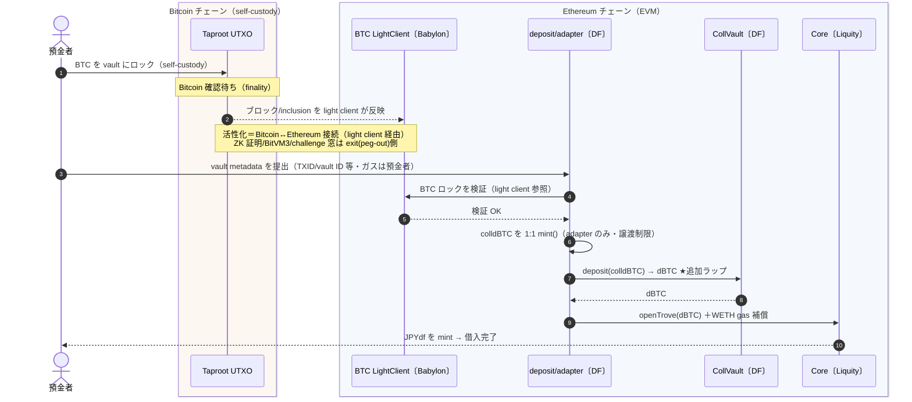
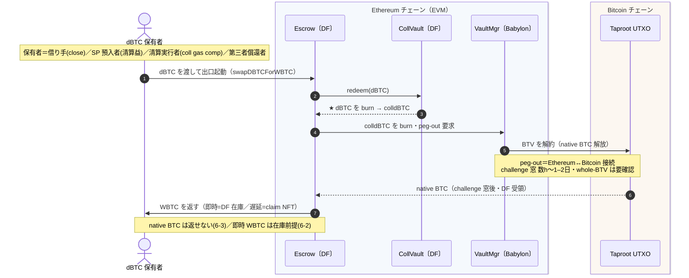
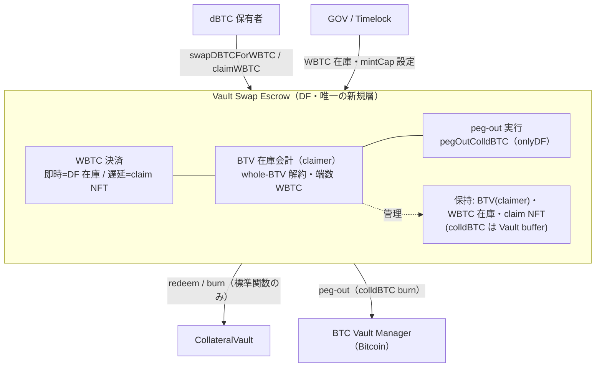

# BTV Collateral Integration

> **位置づけ**: Babylon の `BTV`（Bitcoin 自己管理 vault）を JPYdf の BTC 担保（Branch 4 `dBTC`）として統合する設計メモ。方針は**既存の dToken / CollateralVault を無改変のまま、Babylon 連携を `Vault Swap Escrow` 1 層に吸収**。提案段階（Babylon 認識合わせ ＋ testnet 検証で確定）。正本: [`Parameters.md`](../../../../Parameters.md)（branchとDay1値）／ [Collateral Parameter Policy](../../../product/policies/Collateral-Parameter-Policy.md) §2.4（inert branch受入基準）／ [`Product-Overview.md`](../../../product/Product-Overview.md)（ARCH / SYS-*）／ [`Liquity-v2-Core-Spec.md`](../../../product/spec/Liquity-v2-Core-Spec.md)（清算・償還）／ [`dToken.md`](../../../product/spec/dToken.md)・[`CollateralVault.md`](../../../product/spec/CollateralVault.md)。

## 背景と目的

**目的**: Bitcoin 上の native BTC を**ブリッジ／ラップせず**担保化し、JPYdf を借りられるようにする（Liquity v2 Core は別チェーンの BTC を直接は扱えない）。これを可能にする Babylon の **Trustless Bitcoin Vaults（TBV）** は native BTC を**自己管理のまま** EVM 担保化する protocol で、Aave v4 向けの testnet integration と mainnet 提案が公開されている。本書はそれを参考に**貸し手を Aave → JPYdf（Liquity v2 fork）へ置換**した DF 版を設計する。対応: Aave v4 ↔ JPYdf、`vaultBTC` ↔ `colldBTC` / `dBTC`、`Vault Swap Contract` ↔ `Vault Swap Escrow`。

| 用語 | 意味（出典 = 末尾の参考 gist） |
| --- | --- |
| Babylon | TBV を提供する主体。BTC Vault Manager・keeper・registry を運用する |
| TBV（Trustless Bitcoin Vaults） | BTC をブリッジ／ラップせず、自己管理のまま EVM 担保化する protocol |
| **BTV** | TBV の vault 1 つ。Bitcoin の Taproot に native BTC をロックした **1 UTXO ＝ indivisible・non-fungible**。peg-in で組成、peg-out で解約（challenge 窓を伴う＝**exit 側**。entry には付かない: §3-4）。本番確定値は要確認 |
| **colldBTC** | BTV 持ち分の ERC-20 請求権（TBV×Aave の `vaultBTC` 相当・vault に 1:1）。native BTC への peg-out 権は permissioned |
| **dBTC** | `colldBTC` を underlying とする標準 dToken。JPYdf Core が担保として扱う 18dec ERC-20 |
| **Vault Swap Escrow** | 清算・償還で押収された担保を WBTC へ換えるエスクロー（TBV×Aave の `Vault Swap Contract` 相当）。本書で DF が新設する唯一の層 |

**Aave モデルとの構造差（以降の前提）**: TBV × Aave は**部分清算**で、清算者が担保 vault を直接 seize し、vault が不可分なため目標を超えて押収した分（over-seizure）を WBTC で借り手へ返す。一方 JPY DeFi は **Liquity v2 ＝ 一括清算（部分清算なし）** で、押収担保は清算 keeper ではなく **SP 預入者**へ渡る。この差が清算・第三者償還のパス（§4）と、SP 預入者の出口（dBTC→WBTC）設計（§6-1・§6-2）を分ける。

---

## 1. 設計概要

| 提供元 | 構成要素 |
| --- | --- |
| Babylon | • BTC Vault Manager（BTV 作成・解約・challenge・applications registry）<br>• `colldBTC`、native BTC 償還の許可リスト |
| DF（必須） | • `dBTC`（**標準 dToken**・新規実装なし）<br>• **`Vault Swap Escrow`（唯一の新規層）** ＝ Babylon 連携の実装を全吸収<br>• ※ `CollateralVault` は**標準を無改変で利用**（拡張しない） |

### 1-1. Babylon 提供（既存）

- `BTV`: Bitcoin 上の Taproot スクリプトにロックされた native BTC の自己管理 vault。1 UTXO に対応し indivisible・non-fungible。
- `BTC Vault Manager`: Babylon のコアコントラクト。BTV 作成（peg-in）・担保引き出し（peg-out）・challenge・統合アプリの registry を管理。
- native BTC 償還の許可リスト: native BTC（BTV）を解約できる主体を限定する permissioned list。**DF（の Escrow コントラクト）がメンバーとなる**。
- `colldBTC`: `BTV` 持ち分の ERC-20。native BTC（BTV）への請求権。**DF 側コントラクト（Vault / Escrow）が保有**し、これを burn して native BTC を引き出す権利は permissioned（DF のみ）。
    - ⚠️ **要確認（Babylon）**: `colldBTC` が pool 内で fungible（任意の `colldBTC` が pooled BTV に対し任意額を請求できる）か。non-fungible（特定 BTV 束縛）の場合、Escrow 内に pooling / 在庫管理を持たせる（§5）。なお Aave governance の TBV 提案では `vaultBTC` を「transfer-restricted ERC-20（allowlist 宛先限定）」と明記しており、自由 fungible ではなく allowlist 制限の可能性が高い。

### 1-2. DF 開発（必須）

- `dBTC`: dToken の BTC 版。**標準の dToken 実装をそのまま使う**（新規ロジックなし）。`CollateralVault` の underlying は `colldBTC`、`1 colldBTC = 1 dBTC`（decimals 調整）で連動。Core からは普通の 18dec 担保 ERC20。
- **`Vault Swap Escrow`（唯一の新規コントラクト群）**: Babylon 固有の実装を全吸収する。
    1. `colldBTC` ⇄ native BTC ⇄ WBTC の変換（permissioned な BTV 解約を含む）。
    2. `dBTC → WBTC` の出口提供（清算益・第三者償還で `dBTC` を受け取った主体向け）。
    3. WBTC の決済方式: **即時**（DF 在庫）／ **遅延**（claim Token/NFT・Withdraw Request 形式で Babylon の challenge 期間後）。
    4. （任意）native BTC 売却差益の trustless な還元（§6-1・§6-2）。
    - `colldBTC` の保管は標準 `CollateralVault` の buffer（dBTC と 1:1）。Escrow が内部に持つのは Babylon 固有のもの（BTV 群＝claimer・peg-out 待ち・WBTC 在庫・claim NFT）だけで、Vault には足さない（保持・配線の詳細は §5）。
- ※ `CollateralVault`: **標準を無改変で利用**。`deposit(colldBTC) → mint dBTC` / `redeem(dBTC) → colldBTC` / `burn` の既存 public 関数のみを Escrow が呼ぶ。per-collateral 分岐・新関数・償還待ちプールの追加は**行わない**。

---

## 2. アーキテクチャ（レイヤーと依存方向）

```
┌─ 🔵 Liquity Core（無改変）─────────────────────────────────────────────┐
│  borrow / SP / liquidation / redemption は すべて dBTC を IERC20 として扱う │
│  清算: 担保本体 → SP 預入者(offset) / redistribution / surplus           │
│        keeper は trigger + gas compensation のみ                          │
└───────────────┬───────────────────────────────────────────────────────┘
                │ dBTC（公開・1:1・誰でも保有）
┌─ 🟢 dToken(dBTC) ＋ 🟢 CollateralVault（標準・無改変）───────────────────┐
│  underlying = colldBTC。deposit(colldBTC)→mint / redeem(dBTC)→colldBTC   │
└───────────────┬───────────────────────────────────────────────────────┘
                │ ↑ Escrow は Vault の標準 public 関数(deposit/redeem/burn)を呼ぶだけ
┌─ 🟢 Vault Swap Escrow ＝ 唯一の新規層（Babylon 固有を全吸収）─────────────┐
│  exit : dBTC →[Vault.redeem]→ colldBTC →[DF permissioned]→ native BTC → WBTC │
│         （即時 = DF 在庫 / 遅延 = claim NFT・Withdraw Request）            │
│  entry: native BTC/BTV → colldBTC →[Vault.deposit]→ dBTC                  │
│  colldBTC は Vault buffer が保管／Escrow は BTV(claimer)・WBTC・claim NFT  │
└───────────────┬───────────────────────────────────────────────────────┘
                │ permissioned BTV 解約（DF のみ）
        Babylon: BTV(self-custody) → colldBTC(DF-only claim)
```

- **不変層（無改変）**: 🔵 Core / 🟢 dToken(dBTC) / 🟢 CollateralVault。Core は `dBTC` を普通の担保 ERC20 として扱い、dToken / Underlying / `colldBTC` を知らない（→ [`Liquity-v2-Core-Spec.md`](../../../product/spec/Liquity-v2-Core-Spec.md)）。CollateralVault は `colldBTC` ⇄ `dBTC` の標準ラッパー。
- **新設層**: 🟢 `Vault Swap Escrow`（1 層）。`dBTC` 保有者と `CollateralVault` の**間**（exit 経路）に座り、Babylon 固有処理を吸収。
- **依存方向（一方向）**: Core / CollateralVault / dToken は Escrow を**知らない・呼ばない**。Escrow が CollateralVault の標準 public 関数を呼ぶ片方向のみ。Zapper と同じ「外側の補助層」。
- これにより ARCH-001（Core parity）/ ARCH-002（責務分離）/ ARCH-004（変更は外側に閉じる）を満たす。

---

## 3. BTC の担保化（entry）

entry は **Bitcoin と Ethereum の 2 チェーン**にまたがる。橋渡しはブリッジでなく、**預金者が vault metadata を提出 → コントラクトが Bitcoin light client で BTC ロックを検証する collateral activation**（wrap / bridge しない・litepaper §5/§9）。最短で「Bitcoin 1 tx（確認待ち）＋ EVM 1 tx（提出 → 検証 → mint）」を要し、即時ではない。

### 3-1. シーケンス図（誰が・どのコントラクトを呼ぶか）

`box` の枠が処理チェーン（左 = Bitcoin / 右 = Ethereum）、lifeline が各コントラクト（所有元つき）、実線 `->>` が呼び出し・破線 `-->>` が戻り。② が両チェーンの接続＝collateral activation。



- 所有: Babylon = `BTC LightClient`・`colldBTC` ／ DF = `deposit/adapter`（Vault Swap Escrow）・`CollVault`（CollateralVault）・`dBTC` ／ Core = `BorrowerOperations` / `JpydfToken`。★ = DF 固有の追加ラップ（Aave は `vaultBTC` を直接担保化）。各ステップの権限・信頼は §3-2、確度・要確認は §3-4。

### 3-2. ステップ詳細（主体・チェーン・権限）

| # | チェーン | 主体 | アクション | コントラクト/生成物 | 権限・信頼の注記 |
| --- | --- | --- | --- | --- | --- |
| 1 | Bitcoin | 預金者 | Taproot vault を作成し、**peg-out できる claimer 集合**と challenger 集合を確定 | Bitcoin Taproot script | claimer は**作成時に固定・後から追加不可**。DF Escrow をここで claimer に入れる必要 |
| 2 | Bitcoin | 預金者 | native BTC を UTXO にロック（鍵は本人保持＝self-custody・第三者カストディなし） | `BTV` ＝ 1 UTXO | 分割・rehypothecate 不可 |
| 3 | Bitcoin | — | Bitcoin 確認待ち（finality） | — | Bitcoin の確定性に依存 |
| 4 | Ethereum | **預金者**（frontend/relayer が代理可） | vault metadata（TXID/vault ID 等）を提出 → コントラクトが BTC ロックを検証 | `deposit/adapter` ＋ `BTC light client` | **light client（SPV）検証**で entry を認識・ガスは預金者。**challenge 窓なし**（ZK/BitVM3 は exit 側）。出典 litepaper §5/§9 |
| 5 | Ethereum | DF adapter | vault record に対し **`colldBTC` を 1:1 mint** | DF `Vault Swap Escrow` / adapter | `colldBTC` は譲渡制限・mint/burn は adapter のみ → **ユーザーは保有しない** |
| 6 | Ethereum | DF adapter | `deposit(colldBTC)` → **`dBTC` を mint** | `CollateralVault`（標準・無改変） | ★Aave に無い 1 段（Core は標準 18dec dToken のみ担保化） |
| 7 | Ethereum | position account | `dBTC` を担保に Trove を open（＋WETH gas 補償） | `BorrowerOperations.openTrove` | self-borrow は預金者 EOA が所有。WETH 調達要（§6-4） |
| 8 | Ethereum | Core | 借り手の設定金利で **JPYdf を mint** | 🔵 Liquity Core | Aave の "Hub から借入" を Core の JPYdf 発行が代替 |

> 実運用では **4〜8 を deposit/adapter（or Zapper）が 1 EVM tx に集約**できる（litepaper §9: deposit 契約が lending protocol の関数まで call。体感は「BTC を入れて JPYdf を得る」）。ただし 1〜3（Bitcoin 側）は別チェーン処理のため集約できない。

### 3-3. Aave 版との差（DF 固有の 3 点）

1. **追加ラップが 1 段ある** — Aave は `vaultBTC` を**そのまま**担保にするが、DF は `colldBTC →[CollateralVault.deposit]→ dBTC` を挟んでから Core に渡す（Core は `dBTC` しか知らない）。
2. **entry でも `colldBTC` はユーザーに触れない** — 譲渡制限のため adapter（allowlist 入り）が受領し、ユーザーが手にするのは `dBTC`（自由）か、Zapper 経由なら最初から Trove ＋ JPYdf。
3. **claimer 集合の固定が entry を縛る** — peg-out 主体は vault 作成時に固定で後から足せない。⇒「**vault を作る瞬間に DF Escrow を claimer に指定**」が必須で、「誰が BTV を作るか」を adapter 主導にする設計圧力になる。

### 3-4. 検証済み / 要確認

- ✅ **検証済み（公開ソース・末尾参照）**: ① Taproot UTXO に self-custody でロック・1 vault = 1 UTXO で分割 / pool 不可。② claimer（native BTC を解約できる集合）・challenger（不正 claim を challenge 窓中に異議で止める集合）は **vault 作成時に確定・後付け不可**で集合外は peg-out 不可。claim には host チェーン（EVM）事象の ZK/SNARK 証明が必須、無効 claim は BitVM3 でブロック（預金者を claimer に入れれば self-redemption 可）。③ **entry の認識は Bitcoin light client（SPV）**で BTC ロックを検証し vault record → mint（預金者の提出が起点・ガスも預金者。litepaper §5/§9）。**entry に ZK/BitVM3/challenge 窓は不要**。④ adapter が 1:1 で**譲渡制限 ERC-20**（`vaultBTC` ＝本書 `colldBTC`）を mint・mint / burn は adapter のみ。⑤ challenge 窓（configurable「数時間〜1–2日」）は **exit(peg-out)側**の機構（entry には付かない）。
- ⚠️ **要確認（公開情報に無い／本書の仮定）**: co-signer の正体（本人のみか Babylon operator も関与か）／**entry の light client 実装**（on-chain か off-chain+検証契約か。litepaper §9 は両方許容）／**challenge 窓 vs native BTC 受領総時間**（challenge 窓は configurable で数時間〜1–2日: 公式 blog。native BTC 受領までの総時間は、Aave モデルでは約 3 日: Babylon team が直接確認・設計 gist も同値。両者は別物で、本番確定値は要確認／`colldBTC` の fungibility・解約粒度（§1-1）／DF Escrow が claimer 集合に入る条件・手続き（§7）／`BTC 8dec → colldBTC → dBTC 18dec` の decimals 取り扱い／**Babylon が DF の `CollateralVault`・`Vault Swap Escrow` を colldBTC 転送 allowlist に登録できるか**（不可なら配線の見直しが必要）。
- entry 側の残課題（誰が BTV を作り、`colldBTC` をどう Vault に入れるか）は Next Action で詰める。

---

## 4. dBTC バーン（清算・第三者償還・通常出金）の流れ（exit）

exit は entry の逆向きの 2 チェーン処理。**「dBTC バーン」の実体は `CollateralVault.redeem(dBTC)`**（標準 dToken 償還＝`dBTC` を burn し underlying `colldBTC` を放出）。`colldBTC` が譲渡制限のため、**allowlist の `Vault Swap Escrow` 経由でしか burn できない**（entry の裏返し）。`dBTC` を受け取った主体が Escrow で `dBTC → colldBTC →（peg-out）→ native BTC → WBTC` の出口を得る（誰が `dBTC` を持つかは下記 4 経路）。

**`dBTC` を burn する主体に至る経路は 4 つ**（いずれも「`dBTC` を Escrow に持ち込んで burn」に合流）:

- **通常出金**: 借り手が Trove を close（JPYdf 返済）→ 担保 `dBTC` が戻る。
- **清算益（SP 預入者）**: 清算で押収された `dBTC` の**大半**が **SP 預入者**へ付与（offset・SP 不足分は redistribution・余剰は元借り手へ surplus）。`withdrawFromSP` / `claimAllCollGains` で引き出す。
- **清算実行者（keeper）**: 清算をトリガーした `msg.sender` が **collateral gas compensation**（担保の 0.5%・上限 1,000 dBTC ＝ `min(coll/200, 1_000e18)`）を **dBTC で受領**（固定 WETH gas 補償 0.0375 ETH に加えて。`TroveManager._sendGasCompensation` → `activePool.sendColl`）。少額だが dBTC 保有者として Escrow 出口に合流する。
- **第三者償還**: 償還者が `CollateralRegistry.redeemCollateral` で **Core から `dBTC` を直接受領**（IERC20 移転のみ・Core は Escrow を知らない）。

### 4-1. シーケンス図（誰が・どのコントラクトを呼ぶか）

`box` の枠が処理チェーン（左 = Ethereum / 右 = Bitcoin）、lifeline が各コントラクト、実線 `->>` が呼び出し・破線 `-->>` が戻り。⑤⑥ の peg-out が両チェーンの接続、★ が dBTC バーン。



- 所有: DF = `Escrow`（Vault Swap Escrow）・`CollVault`（CollateralVault）・`dBTC` ／ Babylon = `VaultMgr`（BTC Vault Manager）・`colldBTC`・`BTV`。清算・償還の発生源は Liquity Core。各ステップの権限・信頼は §4-2、確度・要確認は §4-3。

### 4-2. ステップ詳細（呼出元 → 実行コントラクト・チェーン・権限）

| # | チェーン | 主体 | アクション | 実行コントラクト | 権限・信頼の注記 |
| --- | --- | --- | --- | --- | --- |
| 1 | Ethereum | dBTC 保有者 | `swapDBTCForWBTC(dBTC)` で出口起動（dBTC を Escrow へ） | `Vault Swap Escrow` | 誰でも（dBTC は自由保有・自由転送） |
| 2 | Ethereum | Escrow | `redeem(dBTC)` → **dBTC を burn**し colldBTC を受領 | `CollateralVault`（dBTC burn） | ★dBTC バーン。colldBTC は allowlist 宛先のみ受領可 → 保有者は直接 redeem 不可・Escrow 必須 |
| 3 | Ethereum | Escrow / DF | colldBTC を burn し peg-out を要求 | `BTC Vault Manager`（peg-out） | permissioned（DF が vault 作成時の claimer 集合に居る前提＝§3 entry と対） |
| 4 | Bitcoin | DF（claimer） | BTV を解約 → native BTC を解放 | Taproot UTXO / Babylon | challenge 窓 数h〜1–2日・**whole-BTV 単位**（端数は WBTC 精算） |
| 5 | Ethereum | DF / Escrow | native BTC → WBTC、保有者へ返す | `Vault Swap Escrow`（WBTC 決済） | **即時=DF 在庫** / **遅延=claim NFT**（challenge 窓後） |

> **遅延は 2 層ありうる**: (a) 標準 dToken redeem の buffer 不足時は `WithdrawRequest`（colldBTC レベル・VAULT-FR-006）、(b) Bitcoin peg-out の challenge 窓。即時 WBTC 返却は **DF の WBTC 在庫**が前提（§6-2）。`BTV` は部分解約不可のため whole 単位で解約し端数は WBTC 精算（§6-3）。

### 4-3. 検証済み / 要確認

- ✅ **検証済み**: `dBTC` burn = `CollateralVault.redeem`（標準 dToken・dToken 層は permissionless）／ `colldBTC` 譲渡制限のため **Escrow 経由必須**／ peg-out は **permissioned・challenge 窓・whole-BTV 単位**（Babylon TBV / Aave 版仕様）／ `dBTC` burn は `colldBTC` と **1:1 で供給を減らす**（SYS-INV-002 整合）／ 清算実行者は固定 WETH gas 補償 ＋ **coll gas compensation（担保 0.5%・上限 1,000 dBTC）を dBTC で受領**（`TroveManager` L380/480/547・実コード照合済み）。
- ⚠️ **要確認（claiming set / arbitrageur）**: DF を arbitrageur（claimer）として native BTC 償還の許可リストに登録。さらに fallback の第三者 arbitrageur も含め、**vault 作成時に claiming set へ一括登録**する必要（後付け不可）。entry（§3-2）の前提が変わる。Babylon と要調整（§5-4）。
- ⚠️ **要確認**: peg-out の **claimer 手続き・証明提出者**（§3 entry の claimer 集合確定と同根）／ **challenge 窓の確定値**／ **WBTC 即時決済の原資**（§6-2）／ **backing < 1 時の redeem 比率**（`colldBTC < dBTC` となった場合の `backingRatio` 反映）／ 通常 close → redeem が BTC branch で Day-1 有効か。

経済的成立性（償還者が `dBTC → WBTC` で ¥1 相当を実現できるか）・native BTC を返せない制約・WBTC 即時流動性は §6-1 / §6-3 / §6-2 の Key Issue。

---

## 5. Vault Swap Escrow の設計

`Vault Swap Escrow` は Babylon 固有処理（`colldBTC` ⇄ native BTC ⇄ WBTC 変換・permissioned な BTV 解約・WBTC の即時 / 遅延決済）を**すべて吸収**する層（境界・依存方向は §2）。Escrow が内部に持つのは **BTV 群（claimer）・peg-out 待ち・WBTC 在庫・claim NFT**。`colldBTC` 自体は標準 `CollateralVault` の buffer に在庫し（dBTC と 1:1）、Escrow は entry/exit の境界で一時通過させるのみ（→ Vault も `colldBTC` 転送 allowlist に登録が必要）。

### 5-1. 構成図（責務・保持資産・呼び出し境界）

呼び出し元（`dBTC` 保有者・GOV）／ Escrow 内部の責務・保持資産 ／ Escrow が呼ぶ外部（`CollateralVault`・`BTC Vault Manager`）。



### 5-2. 責務・決済・インターフェース

- **WBTC 決済の 2 形態**（要決定・§6-2）: ① **即時** — DF が WBTC 在庫を持ち `dBTC` 持ち込みに即 WBTC を返す（在庫 = critical path）。② **遅延** — claim Token/NFT を発行し、`colldBTC → native BTC → WBTC`（challenge 期間）後に引換（Withdraw Request 形式）。
- **どちらを選ぶかは `dBTC` 保有者の選択**: 即時は約 1% の haircut を払って今すぐ WBTC を得る（haircut は arbitrageur が約 3 日のリスクを取る取り分）。遅延は haircut を避けて満額に近づくが、保有者自身が約 3 日の challenge リスクを負う。
- **BTV 在庫管理**: Escrow が `dBTC` supply を裏付ける BTV 群を claimer として保持し、peg-out 要求に whole-BTV を解約（端数は WBTC 精算）。

| 責務 | 関数 | 内部動作 | 権限 |
| --- | --- | --- | --- |
| exit 受付 | `swapDBTCForWBTC(dBTC, receiver)` | `CollateralVault.redeem`（dBTC burn）→ 即時 WBTC または claim 発行 | 誰でも |
| 遅延引換 | `claimWBTC(claimId)` | claim NFT を WBTC と引換 | claim 保有者 |
| peg-out | `pegOutColldBTC(amount)` | colldBTC burn → `BTC Vault Manager` で BTV 解約 → native BTC | **onlyDF** |

インターフェース・スケッチ（illustrative・確定仕様ではない）:

```solidity
interface IVaultSwapEscrow {
    function swapDBTCForWBTC(uint256 dBTCAmount, address receiver)
        external returns (uint256 wbtcOut, uint256 claimId);   // 即時 WBTC または claim
    function claimWBTC(uint256 claimId) external returns (uint256 wbtcOut); // 遅延決済の引換
    function pegOutColldBTC(uint256 colldBTCAmount) external onlyDF;        // colldBTC burn → BTV 解約
}
```

> Escrow は `CollateralVault` の標準関数（`redeem` / `burn`）を呼ぶのみ。`CollateralVault` / `dToken` のコードには一切手を入れない。

### 5-3. 要決定 / 要確認

- 🔧 **要決定**: WBTC 決済方式（即時 / 遅延）と在庫の引受主体（§6-2 の critical path）。WBTC 在庫に応じた動的 mintCap も選択肢。
- ⚠️ **要確認**: `colldBTC` が **non-fungible**（特定 BTV 束縛）なら Escrow 内に明示的な **pooling 機構**が要る（§1-1）。fungible なら単純な在庫会計で足りる。
- ✅ **確定（設計境界）**: Core / Vault / dToken 無改変（§2）。`dBTC` burn・peg-out の挙動は §4 と一致。

---

### 5-4. LLV / arbitrageur 経路（提案・Babylon team 議論反映）

> 本節は Babylon team との議論で合意した方向性。確定仕様でなく提案で、末尾に要決定/要確認を残す。

Babylon の TBV × Aave では、清算者の出口として **LLV（liquidation liquidity venues）** と、native BTC を peg-out する permissioned な **arbitrageur** が用意されている。JPY DeFi は以下の形で取り込む。

- **独自 LLV**: 本書の `Vault Swap Escrow` が JPYdf の LLV を兼ねる。即時 WBTC の haircut は **1%**。
- **DF が arbitrageur の1社になる**: DF（の Escrow）を native BTC 償還の許可リスト（claiming set）に登録してもらう。claimer は **vault 作成時に固定・後付け不可**のため、entry（§3-2）で全 vault 作成時に **DF および fallback の第三者 arbitrageur** を claiming set に入れることが前提（§4-3 要確認）。
- **即時 WBTC の調達**: DF が **Aave v3 から WBTC を借りて**即時払いを賄う。現行 `CollateralVault` / `Strategy` は借入を想定していないため、Aave v3 担保を積むための **資金（DF の capital）** が要る可能性。捌ける volume はこの担保量で律速される（= Babylon team の言う「arbitrageur がどれだけ資本を割けるか」の JPYdf 版。Aave Hub は即時 front を均す短期バッファで、3 日ロックの資本は arbitrageur=DF が担う）。

経路は `dBTC` 提供者が即時 WBTC を望むかで分かれる。

**即時 WBTC を望む場合（haircut 1%）**
- 第一のパス: DF が arbitrageur として native BTC を peg-out し、**haircut（1%）から Aave v3 の借入金利を工面**。holder は 0.99 相当を即時受領。
- DF が実行できない場合: 第三者 arbitrageur が実行し、**haircut（1%）は第三者が得る**（即時は誰かが資本を front するため、front した側が 1% を取る）。

**3 日待つ場合（full value）**
- 第一のパス: DF が arbitrageur として native BTC を peg-out し、**full value を償還 token 保有者に渡す**（遅延を選んだ holder が 3 日リスクを負うので haircut は乗らない）。
- DF が実行できない場合: 第三者 claimer に peg-out を依頼し、その **役務費（1% より小さい実行 + challenge リスク分）を DF が負担**して、holder には full value を渡す。DF が「遅延 = full value」を保証する。

### 5-4-1. 要決定 / 要確認

- 🔧 **要決定**: Aave v3 借入の担保の出所。(a) DF 自前 treasury（clean だが DF の capital 要）か、(b) branch underlying（branch 0/1 の Aave V3 供給分）の rehypothecation（追加資金ゼロだが branch 隔離・dToken 裏付け SYS-INV-002/004 に影響、保守的運用 + risk-governance 承認が前提）か。
- ⚠️ **要確認（peg 床）**: 即時を選ぶ**第三者償還者**には 1% haircut が乗り、redemption の peg 床が ~1% 下がる。清算と違い 5% penalty が無く self-financing できないため、redemption fee と合わせて要設計（§6-1）。
- ⚠️ **要確認（claiming set）**: DF + fallback の第三者 arbitrageur（例: Babylon の 5 社）を **vault 作成時に claiming set へ登録**できるか。後付け不可のため entry 要件に直結（Babylon と要調整）。

---

## 6. Key Issues（open）

> **6-1〜6-3 は共通根から派生する。** 根 ＝「`dBTC` の唯一の出口が Escrow 経由の `dBTC → WBTC`（native BTC では戻せず、変換に**割引・challenge 窓・WBTC 原資**を伴う）」。そこから軸の異なる3問が出る: **6-1 = ペグ経済**（裁定が回るか）／**6-2 = 原資・流動性**（即時 WBTC を出せるか・6-1 の前提）／**6-3 = 資産性の制約**（WBTC 止まり・回避不能）。6-1・6-2 は対の **Day-1 gate**、6-3 は accepted constraint ＋ 緩和。

### 6-1. 第三者償還の裁定が成立せず、ペグ床が崩れるリスク（経済軸）

- 償還（Redemption）は「1 JPYdf = ¥1 分の担保」を裁定者が**儲かる時だけ**実行することで JPYdf のペグ床を作る機構。成立には「受領担保を ¥1 分に**即換金できる**」必要がある。
- BTC branch は受領物が `dBTC` で、価値化は Escrow の `dBTC → WBTC` 一択。そこに**割引**（DF の非同期・WBTC 在庫リスク補償。実装上は約 1%＝arbitrageur が約 3 日のリスクを取る取り分・Babylon の LLV モデル）＋**遅延**（peg-out の challenge 窓）が乗り、`JPYdf の割安幅 < WBTC 割引 ＋ 償還手数料` になると裁定が赤字化 → **償還が起きない ＝ ペグ床が消える**。JPYdf 債務は全 branch 共通（**SYS-INV-004 の隔離限界**）・償還は全 branch 按分のため、BTC branch の不全は **JPYdf 全体のペグを押し下げ得る**。
- → 活性化前に**裁定が黒字で回る償還経路** ＝ **有界割引（haircut 上限固定）× 同期決済（即時 WBTC）**を定義する（床は ¥(1 − haircut − 手数料) 付近へ僅かに下がるが“床として残る”）。`SYS-RISK-001` / `SYS-RISK-002` と同格の **Day-1 gate**。実現原資は **6-2 に依存**。

### 6-2. dBTC → WBTC の即時決済を支える WBTC 原資（流動性軸・critical path）

- 6-1 の「同期決済（即時 WBTC）」と清算 exit の双方が、**Escrow が即時に渡せる WBTC 在庫**を前提にする。設計論点 ＝ 在庫の出し手・サイズ、決済方式（即時 vs 遅延 claim）、**challenge 窓（数日）の引受リスクを誰が負うか**、WBTC 在庫に応じた**動的 mintCap**。
- Aave 連携では清算層へ WBTC を渡すのは Aave 自身。JPY DeFi では **DF（Escrow / treasury）がこの原資提供を負う**（＝新興プロトコルの critical path）。**6-1 の Day-1 gate を満たす実体がこれ**。
- ⚠️ 提案（§5-4）: 即時 WBTC は DF が **Aave v3 から借りて**賄い、haircut（1%）で借入金利を回収する（清算は 5% penalty が吸収。償還は self-financing できず peg 床が下がる点は要設計）。DF の負担は「Aave v3 に積む担保」に置き換わり、捌ける volume はその担保量で律速。詳細は §5-4。

### 6-3. 出口が WBTC 止まりで native BTC に戻せない（資産性の制約・回避不能）

- 清算・第三者償還で BTV が解約されると、その Trove は native BTC を失い、残余（過剰担保・端数）も **WBTC でしか返せない**（`BTV` 部分解約不可ゆえの**回避不能な制約**で、6-1/6-2 のような「設計で消せる問題」ではない）。
- 緩和は保守的な LTV・金利調整・担保積み増しで清算 / 償還の確率を下げる方向（self-borrow Trove ＋ off-chain keeper、または Liquity native の delegation / batch manager）。native BTC への復帰は保証されない accepted constraint。

### 6-4. WETH gas deposit の調達

- Liquity v2 は Trove open ごとに `ETH_GAS_COMPENSATION`（WETH 建ての固定 gas 補償。close で返却 / 清算時に keeper へ）の前納を要する。「BTC だけ預ける」UX（Zapper）に **WETH 調達**を織り込む必要がある。

---

## 7. Next Action

- Testnet（Sepolia）で仮説検証（Aave 系のみ。vault 作成 → borrow → repay → withdraw）。`BTV` 自体の GitHub は未公開のため、実挙動チェックはここが最適。
- Babylon team への確認（DF チーム認識合わせ後）:
    - **`colldBTC` の fungibility / 解約粒度 / challenge 期間**（§1-1・§5 の要確認）。
    - native BTC 出金許可リスト入りの条件・手続き。
    - registry 登録要件（`Vault Swap Escrow` 関連）。
    - $BABY インセンティブの可否（6-2 の補強）。
    - **BTV を誰が作成するか**（vault 作成時に claimer 集合へ DF Escrow を確実に入れる主導権。後付け不可のため。§3-2）。
    - **vault の co-signer 構成**（本人のみか Babylon operator も関与か）と **entry の light client 実装**（on-chain / off-chain+検証契約）。
    - **decimals 取り扱い**（`BTC 8dec → colldBTC → dBTC 18dec` の換算・丸め）。
- 6-1（償還裁定）・6-2（WBTC 原資）の経済設計を詰める。

---

### 参考文献 / 関連要件

- [Aave Governance: Temp Check — Babylon Trustless BTC Vault Integration on Aave v4](https://governance.aave.com/t/temp-check-babylon-trustless-btc-vault-integration-on-aave-v4/24964)（vaultBTC=譲渡制限・mint/burn は adapter のみ・permissioned redemption・Hub/Spoke）
- [Babylon: What is TBV — Trustless Bitcoin Vaults（公式 docs）](https://docs.babylonlabs.io/trustless-bitcoin-vault/start-here/what-is-tbv/)
- [Babylon: Trustless BTCVault 101](https://babylonlabs.io/blog/trustless-btcvault-101)（peg-in / 活性化 / claimer・challenger 集合 / challenge 窓 数h〜1–2日 の機構）
- [Babylon × Aave Labs partnership announcement](https://babylonlabs.io/blog/babylon-labs-and-aave-labs-partner-to-bring-native-bitcoin-backed-lending-to-aave-v4)（Taproot UTXO → vault record → adapter→vaultBTC の entry 概観）
- [Babylon: TBV litepaper（PDF・**一次情報**）](https://docs.babylonlabs.io/papers/trustless-bitcoin-vaults.pdf) — §5（vault metadata 提出 → light client 検証 → collBTC mint）／§9（deposit 契約が mint/burn controller・lending protocol を call）。entry=light client 認識・ZK/challenge は exit 側、の根拠
- Liquity v2 GitHub: [v2 docs](https://docs.liquity.org/) / [bold](https://github.com/liquity/bold)
- 関連要件・制約（本設計が満たすべきもの）: ARCH-001 / 002 / 004（Core parity・責務分離・変更は外側）, SYS-CON-002（外部 IF は担保 ERC20 ＋価格のみ）/ SYS-CON-003（18dec）, SYS-INV-002 / 003 / 004（dToken 請求権整合・供給単一・branch 隔離限界）, [ADR-001 / 002 / 006](../../../product/architecture/Architecture-Decision-Records.md)（base-parity fork・dToken+Strategy・backing 毀損時挙動）, [Day1 Parameter Manifest](../../../../Parameters.md)（Branch 4 = dBTC）、[Mainnet Launch Product Decision Record](../../../launch/decisions/Mainnet-Launch-Product-Decision-Record.md)（inert状態）、[Collateral Parameter Policy](../../../product/policies/Collateral-Parameter-Policy.md) §2.4と [Inert Branch Activation Runbook](../../../operations/runbooks/Inert-Branch-Activation-Runbook.md), [`Product-Overview.md`](../../../product/Product-Overview.md) §6.1（inert 活性化と、収まらない場合の全体再デプロイ＝移行）。
