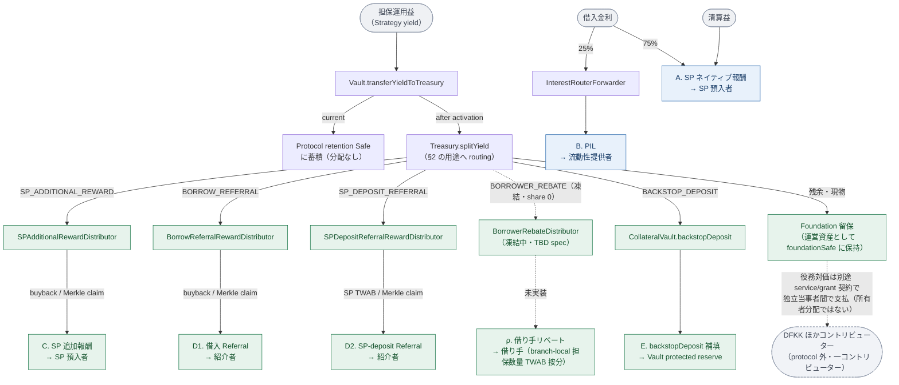

# プロトコル収益 → 利用者還元・backstop 補填の経路と配分

## 0. 位置づけ

本書は、**プロトコル収益から利用者へ還元される経路と backstop 補填を一望し、担保運用益（Strategy yield）の用途配分を定める正本**である。各経路の機構・実装は下位の正本が持ち（末尾「参考: 関連正本」）、本書はそれらへ橋渡しし、**担保運用益をどの用途へどの比率で配分するか**（=各所が参照する単一の budget table）だけを正本として定める。

> **Status**: Future allocation policy。配分の枠組みは確定、具体比率は §2 のとおり TBD。現行の留保・照合・cutover は [Treasury Safe Retention Runbook](../../operations/runbooks/Treasury-Safe-Retention-Runbook.md) を正本とする。

---

## 1. 還元経路の全体像

利用者へ還元される経路と backing 保護の経路は 7 系統（A / B / C / D1 / D2 / ρ / E）。原資・状態が異なる。配布先・配布フローは下図、状態・正本は表に示す。ρ（借り手リベート）は 2026-07-16 に**比率 0 の dormant bucket**として追加したが、2026-07-17 の意思決定で active allocation としては発動しない。新しい再評価決定まで share 0 / destination unset を維持し、手動支払・Distributor・UI 還元表示を開始しない。

> **凡例**: 角丸＝原資。🔵 A/B（青）＝Core 由来。🟢 C/D/ρ/E/F（緑）＝担保運用益由来。ρ は [Yield-Sharing-Rollout-Plan](./Yield-Sharing-Rollout-Plan.md) の再評価 gate を満たす新しい決定まで share 0 / destination unset とする。Protocol retention Safe は Protocol Treasury の一時留保先であり、Foundation 運営資産の `foundationSafe` とは区別する。**F（Foundation 留保）＝残余を `foundationSafe` に運営資産として保持**し、on-chain の資金流出先は Foundation operating-asset Safe (`foundationSafe`) に限られる（[`Treasury.md`](../spec/Treasury.md) TRSY-INV-001）。DFKK ほかコントリビューターへの役務対価は、この on-chain 配分と分離して service/grant 契約で支払う（性格づけ・確認事項は §2「配分規律」）。

| 経路 | 原資 | 機構・判断の正本 |
| --- | --- | --- |
| **A. SP ネイティブ報酬** | 借入金利 75% ＋ 清算益 | Core Spec |
| **B. PIL** | 借入金利 25% | PILAllocator |
| **C. SP 追加報酬** | 担保運用益 | SPAdditionalRewardDistributor |
| **D1. 借入 Referral** | 担保運用益 | BorrowReferralRewardDistributor / Referral-Program-Policy |
| **D2. SP-deposit Referral** | 担保運用益 | SPDepositReferralRewardDistributor / Referral-Program-Policy |
| **ρ. 借り手リベート** | 担保運用益 | [Yield-Sharing-Rollout-Plan](./Yield-Sharing-Rollout-Plan.md)（凍結決定・再評価 gate） |
| **E. backstopDeposit 補填** | 担保運用益 | CollateralVault / Treasury |

**C・D1・D2・ρ・E は同一原資（担保運用益）**で、その按分は §2 が定める。A・B は別原資のため §2 の対象外。

---

## 2. 担保運用益の用途配分

activation 後は、担保運用益を次の 6 用途（purpose bucket）に**合計 100%** で配分する。Treasury は用途別宛先へ Underlying を routing するだけで、buyback / Merkle claim / Referral claim は受け取り先コントラクトが担う。backstop 補填は対象 Vault の `backstopDeposit` に入金し、通常 redeem / claim 用 buffer とは分けて protected reserve として扱う。比率は TBD とし、Treasury activation Decision Record と verified manifest で確定する。

| Purpose bucket | 比率 | 配布手段 |
| --- | --- | --- |
| **C. SP 追加報酬** | `α` | Treasury → `SPAdditionalRewardDistributor`（buyback・TWAB・cumulative Merkle claim） |
| **D1. 借入 Referral** | `β` | Treasury → `BorrowReferralRewardDistributor`（buyback・campaign root・cumulative Merkle claim） |
| **D2. SP-deposit Referral** | `γ` | Treasury → `SPDepositReferralRewardDistributor`（buyback・SP TWAB root・cumulative Merkle claim） |
| **ρ. 借り手リベート** | `ρ` | **share 0 / destination unset で凍結**。将来再評価時の候補は `BorrowerRebateDistributor`（TBD spec）だが、現行 routing / Safe 支払は存在しない |
| **E. backstopDeposit 補填** | `κ` | Treasury → registered `CollateralVault.backstopDeposit`（Underlying 現物・protected reserve） |
| **Foundation 留保**（運営資産） | `δ`（残余） | Treasury → Foundation operating-asset Safe (`foundationSafe`)（Underlying 現物）。DFKK 等への役務対価はこの留保と分離（下記規律） |

**配分規律**:

- **単一 budget table**: 担保運用益の全用途を本表 1 箇所で割り当て、同一 yen/token を 2 用途に重複計上しない。
- **合計 100% ＋ Foundation 最低取り分**: `α+β+γ+ρ+κ+δ = 100%`、`δ` は hard bound 以上（[`Treasury.md`](../spec/Treasury.md) TRSY-INV-002 が `Σ purposeShareBps` に上限を課し、残余 `δ` の最低取り分を構造保証する）。`δ` の on-chain 宛先は `foundationSafe` に限られる（TRSY-INV-001）。
- **`δ` は「Foundation 運営資産としての留保」であって DFKK への分配・保証取り分ではない**: `δ` は役務量に連動しない保証最低取り分（TRSY-INV-002 の hard bound）であり、これを DFKK ほかコントリビューターへの所有者分配・保証支払と読める設計にはしない。DFKK 等への支払は、この留保と分離し、**実際に提供された役務（開発・非独占フロントエンド運用・マーケ等）への独立当事者間の相当対価**として service / grant 契約で行う（[`Foundation-Entity-Setup-Requirements.md`](../../../foundation/requirements/Foundation-Entity-Setup-Requirements.md) §7・§4＝独立当事者間取引／§5＝(A) Foundation 運営資産と (B) Protocol Treasury の分離）。本書は値・比率を変えず、性格づけ（誰の何の対価か）のみを定める。
  - ［要専門家確認（税理士・RMI カウンセル）］ Foundation を RMI 非営利 entity として設立する場合、その余剰を Member・役員・所有者へ分配することは非営利法上の inurement（利益供与）禁止に触れ得る一方、役務への相当対価の支払は許容される（法域の当てはめは [`Foundation-Entity-Setup-Requirements.md`](../../../foundation/requirements/Foundation-Entity-Setup-Requirements.md) を正本とする）。`δ` を「保証取り分の DFKK への流入」と性格づけると、(1) Foundation の非営利ステータス毀損、(2) 日本の移転価格税制／国外関連者への寄附金の全額損金不算入（措法 66 条の 4 第 3 項）に係るリスクを高め得る。相当対価性（役務との対応・独立当事者間価格）の判断は §3 の税務・会計オーナー承認および RMI カウンセル確認に委ねる。
- **未確定・凍結 bucket は 0**: 前提条件が未確定の bucket（例: SP-deposit Referral）と、active allocation を発動しない ρ は比率 0 とし、その分を他用途へ配分する。
- **ρ（借り手リベート）の位置付け**: E1 分析で検討した将来オプションを失わないための dormant bucket。D1 は不発動で決定し、share 0 / destination unset を維持する。按分・Safe 支払・Merkle claim・backingRatio 上振れ反映は現行仕様ではなく、[Yield-Sharing-Rollout-Plan](./Yield-Sharing-Rollout-Plan.md) の再評価 gate を満たす新しい決定と設計レビューが必要である。[P5a 検証メモ](../../../engineering/historical-reviews/2026-07-16-P5a-TWAB-Feasibility-Memo.md) は技術 evidence であり、支払開始の根拠ではない。
- **支払データを作らない**: 凍結中は self-mint、ゼロ分母、TWAB、epoch、dust 等の支払規律を active policy として定めず、支払 CSV / Merkle root / claim を生成しない。
- **変更は将来効**: 比率変更は以後の `splitYield` にのみ適用（確定済み分は再配分しない）。
- **Referral は cap 運用**: 獲得効率次第の変動費のため固定 payout を保証せず、budget/partner/per-wallet cap で管理する（[`Referral-Program-Policy.md`](../../operations/policies/Referral-Program-Policy.md) §4.3）。
- **手作業配布は Foundation 運営資産側で扱う**: Referral を Safe Wallet から手作業支払する運用を選ぶ場合は、該当 Referral bucket の比率を 0 にし、その分を Foundation 留保へ寄せる。Treasury から Referral distributor へ送った budget を手作業支払用に戻す通常経路は持たない。
- **backstop 通常枠と緊急枠を分ける**: `κ` は通常時の backstopDeposit 補填 bucket。backing 毀損時は C/D1/D2/ρ/Foundation への通常 routing を停止していても、Treasury は登録済み Vault の不足額まで `emergencyBackstopDeposit` を実行できる（[`Treasury.md`](../spec/Treasury.md) TRSY-FR-007）。既に distributor / Foundation へ送付済みの budget は Treasury へ自動回収しない。

---

## 3. 未確定事項（TBD）

| 未決 | 確定先 |
| --- | --- |
| 6 用途の具体比率 `α/β/γ/ρ/κ/δ` | §2 → Treasury activation Decision Record / verified manifest |
| ρ の将来再評価 | [Yield-Sharing-Rollout-Plan](./Yield-Sharing-Rollout-Plan.md) §3。現在は D1 不発動、D2-D4 凍結 |
| Referral の cap 値（budget/partner/per-wallet） | [`Referral-Campaign-Activation-Gate.md`](../../operations/runbooks/Referral-Campaign-Activation-Gate.md) |
| 緊急 backstop 補填後に通常 routing をいつ再開するか | incident policy / governance decision（別途確定） |
| SP-deposit Referral の attribution 方式 | sJPYdf / wrapper 設計（別途確定） |
| 担保運用益を Referral 原資に充てるための governance / 税務・会計オーナー承認 | [`Referral-Program-Policy.md`](../../operations/policies/Referral-Program-Policy.md) §7.2 / ガバナンス承認 |
| `δ`（Foundation 留保）と DFKK 役務対価の性格づけ（inurement 回避・相当対価性・独立当事者間価格。上記の税務・会計オーナー承認と連結） | RMI カウンセル ／ 税理士 ／ [`Foundation-Entity-Setup-Requirements.md`](../../../foundation/requirements/Foundation-Entity-Setup-Requirements.md) |

> Treasury は用途別 routing だけを規定する。3種の配布先における buyback / root / claim は [`Reward-Distributors.md`](../spec/Reward-Distributors.md) が規定する。ρ の attribution / claim は現行仕様に含めず、[Yield-Sharing-Rollout-Plan](./Yield-Sharing-Rollout-Plan.md) の再評価 gate を満たす場合に future `BorrowerRebateDistributor.md` で再設計する。

---

## 参考: 関連正本

各経路の機構・実装は下位の正本が持つ（本書では再記述しない）。

| 関連正本 | 役割 |
| --- | --- |
| [`Liquity-v2-Core-Spec.md`](../../product/spec/Liquity-v2-Core-Spec.md) | SP ネイティブ報酬（借入金利 75%・清算益）・借入金利の 75/25 分割 |
| [`PILAllocator.md`](../../product/spec/PILAllocator.md) | PIL（借入金利 25%）の流動性インセンティブ配分 |
| [`Treasury.md`](../spec/Treasury.md) | `Treasury.sol` の用途別 routing・固定宛先・比率統制 |
| [`CollateralVault.md`](../../product/spec/CollateralVault.md) | `backstopDeposit` / protected reserve / backingRatio |
| [`Reward-Distributors.md`](../spec/Reward-Distributors.md) | SP 追加報酬・借入 Referral・SP-deposit Referral の buyback・root・Merkle claim |
| [`Yield-Sharing-Rollout-Plan.md`](./Yield-Sharing-Rollout-Plan.md) | ρ の凍結決定・再評価 gate |
| [`Referral-Program-Policy.md`](../../operations/policies/Referral-Program-Policy.md) | Referral の計測・attribution・abuse/clawback・frontend/ledger gate |
| [`Balance-Sheet-Liquidity-Allocation-Policy.md`](../../../contributors/deltaforesight/policies/Balance-Sheet-Liquidity-Allocation-Policy.md) | 会社 B/S 自己資金の投下（原資が別。本書と混同しない） |
